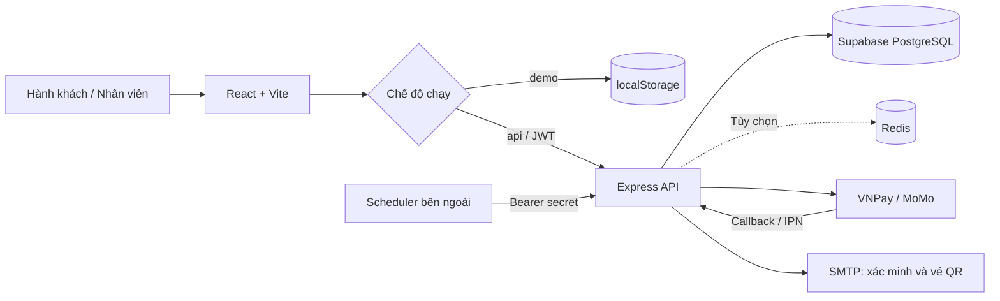
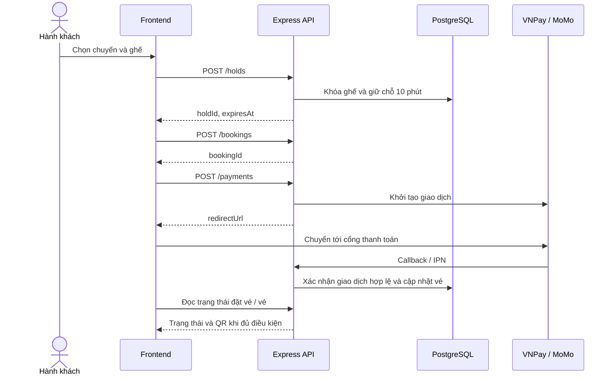

# SmartBus — Hệ thống bán vé và quản lý xe buýt thông minh

**Đồ án Thực tập Cơ sở 2026 · Nhóm 5 — N5 Innovators**

Trường Đại học Công nghệ Thông tin & Truyền thông — Đại học Thái Nguyên (ICTU).

SmartBus kết nối hành khách, tài xế, bộ phận điều hành và tài chính trong cùng một ứng dụng web: tra cứu chuyến, giữ ghế, thanh toán trực tuyến, nhận vé QR, theo dõi xe và quản lý vận hành. Giao diện sử dụng **tiếng Việt**, tiền tệ **VND** và múi giờ **`Asia/Ho_Chi_Minh` (UTC+7)**.

[Mã nguồn](https://github.com/tamtran2k6zz/Project_Smart_Bus_Ticketing_System_ictu) · [Web app](https://smart-bus-ticketing-system.vercel.app) · [CI](https://github.com/tamtran2k6zz/Project_Smart_Bus_Ticketing_System_ictu/actions/workflows/ci.yml) · [Báo lỗi](https://github.com/tamtran2k6zz/Project_Smart_Bus_Ticketing_System_ictu/issues)


> README được đối chiếu với mã nguồn ngày **12/10/2026**. Liên kết web app là địa chỉ triển khai của dự án; tính sẵn sàng và phiên bản đang phục vụ cần kiểm tra trên môi trường triển khai. Ảnh minh họa là bản chụp giao diện đã lưu trong repository.

## Mục lục

- [Tổng quan và phạm vi chức năng](#tổng-quan-và-phạm-vi-chức-năng)
- [Vai trò và phân quyền](#vai-trò-và-phân-quyền)
- [Công nghệ và kiến trúc](#công-nghệ-và-kiến-trúc)
- [Yêu cầu môi trường](#yêu-cầu-môi-trường)
- [Chạy nhanh chế độ demo](#chạy-nhanh-chế-độ-demo)
- [Chạy với API và PostgreSQL](#chạy-với-api-và-postgresql)
- [Cấu hình môi trường](#cấu-hình-môi-trường)
- [Chạy bằng Docker Compose](#chạy-bằng-docker-compose)
- [Luồng đặt vé và thanh toán](#luồng-đặt-vé-và-thanh-toán)
- [Xác minh email và gửi vé](#xác-minh-email-và-gửi-vé)
- [Soát vé và theo dõi xe](#soát-vé-và-theo-dõi-xe)
- [Đường dẫn giao diện](#đường-dẫn-giao-diện)
- [API chính](#api-chính)
- [Cơ sở dữ liệu và migration](#cơ-sở-dữ-liệu-và-migration)
- [Kiểm thử và build](#kiểm-thử-và-build)
- [Triển khai và vận hành](#triển-khai-và-vận-hành)
- [Xử lý lỗi thường gặp](#xử-lý-lỗi-thường-gặp)
- [Cấu trúc repository và tài liệu](#cấu-trúc-repository-và-tài-liệu)
- [Quy trình đóng góp](#quy-trình-đóng-góp)
- [Đội ngũ phát triển](#đội-ngũ-phát-triển)
- [Giấy phép](#giấy-phép)

## Tổng quan và phạm vi chức năng

Hệ thống cung cấp hai chế độ chạy riêng biệt:

| Nội dung           | Chế độ demo                            | Chế độ API                             |
| ------------------ | -------------------------------------- | -------------------------------------- |
| Cấu hình           | `VITE_APP_MODE=demo`                   | `VITE_APP_MODE=api` — mặc định         |
| Dữ liệu            | Dữ liệu mẫu trong localStorage         | PostgreSQL qua Express API             |
| Backend / database | Không cần                              | Bắt buộc                               |
| Xác thực           | Tài khoản và phiên demo                | JWT, bcrypt, trạng thái tài khoản      |
| Thanh toán         | Mô phỏng kết quả giao dịch             | VNPay / MoMo khi cấu hình merchant     |
| Email              | Không gửi email thật                   | Xác minh và gửi vé qua SMTP            |
| Vị trí xe          | Chuyển động và ETA mô phỏng            | Vị trí đã được cập nhật vào backend    |
| Mục đích           | Trải nghiệm giao diện, trình diễn, E2E | Tích hợp, kiểm thử dịch vụ, triển khai |

**Các chức năng đã có trong mã nguồn:**

- **Hành khách:** đăng ký, đăng nhập bằng email/số điện thoại, xác minh email, tìm chuyến theo hành trình/ngày, chọn và giữ 1–6 ghế, đặt vé, áp dụng voucher, thanh toán, xem vé QR, gửi yêu cầu hủy/đổi và phản ánh.
- **Tài xế / nhân viên:** xem chuyến được phân công, soát vé, xem danh sách đã lên xe, cập nhật vị trí và báo cáo sự cố.
- **Điều hành:** quản lý tuyến, thứ tự trạm, xe, lịch chạy, nhân sự và phân công; xử lý hỗ trợ, yêu cầu vé và hồ sơ ưu đãi.
- **Tài chính / quản trị:** báo cáo theo bộ lọc, xuất Excel/PDF, quản lý khuyến mãi; quản trị viên quản lý thêm người dùng và nhật ký thao tác.
- **Backend:** transaction và khóa hàng PostgreSQL, Redis tùy chọn cho luồng khóa legacy, xác minh callback thanh toán, xử lý hoàn tiền, giải phóng giữ chỗ hết hạn và hàng đợi email vé.

**Giới hạn hiện tại:**

| Hạng mục                | Trạng thái trong chế độ API                                                            |
| ----------------------- | -------------------------------------------------------------------------------------- |
| Quên mật khẩu           | Có trang giao diện; endpoint khôi phục trả HTTP `503`                                  |
| Mua vé tháng            | Có khu vực vé tháng/hồ sơ ưu đãi; `POST /passes` trả `503`, chưa mở bán trực tuyến     |
| ZaloPay                 | Chưa được hỗ trợ bởi endpoint thanh toán của giao diện mới                             |
| Lựa chọn `Card`         | Đi qua VNPay, không phải tích hợp cổng thẻ riêng                                       |
| Đặt vé không chọn ghế   | Có trong demo; API giữ chỗ yêu cầu danh sách ghế cụ thể                                |
| GPS / ETA               | Cần nguồn cập nhật vị trí; hiển thị bản đồ không xác nhận đã kết nối thiết bị GPS thật |
| PDF / biên nhận         | Không thay thế tích hợp hóa đơn điện tử hợp pháp                                       |
| Thanh toán / email thật | Cần merchant, callback công khai, SMTP và nghiệm thu riêng                             |

API báo lỗi khi không kết nối được dịch vụ; không tự chuyển sang dữ liệu demo.

## Vai trò và phân quyền

| Vai trò         | Mã          | Phạm vi chính trên giao diện                       |
| --------------- | ----------- | -------------------------------------------------- |
| Hành khách      | `PASSENGER` | Đặt vé và quản lý dữ liệu cá nhân                  |
| Tài xế / phụ xe | `DRIVER`    | Chuyến được phân công, soát vé và sự cố            |
| Điều hành       | `MANAGER`   | Vận hành, soát vé, hỗ trợ, duyệt ưu đãi và báo cáo |
| Tài chính       | `FINANCE`   | Báo cáo và khuyến mãi                              |
| Quản trị viên   | `ADMIN`     | Toàn bộ phân hệ quản trị, người dùng và audit      |

Frontend dùng [permissions.ts](frontend/src/configs/permissions.ts) để bảo vệ các khu vực. Backend kiểm tra JWT, vai trò, quyền sở hữu tài nguyên và phân công chuyến trên các endpoint tương ứng; ẩn nút ở frontend không thay thế kiểm tra quyền tại API.

## Công nghệ và kiến trúc

| Thành phần            | Công nghệ / vai trò                                                      |
| --------------------- | ------------------------------------------------------------------------ |
| Giao diện             | React 19, TypeScript, Vite 8, React Router 7, CSS Modules, anime.js 4    |
| Dữ liệu / biểu mẫu    | TanStack Query, Axios, Zustand, React Hook Form, Zod                     |
| Bản đồ / báo cáo / QR | Leaflet, Recharts, ExcelJS, jsPDF, qrcode, html5-qrcode                  |
| Backend               | Express 4, TypeScript, JWT, bcrypt, Nodemailer, `ws`                     |
| Database              | PostgreSQL trên Supabase, truy vấn bằng `pg`, migration SQL, RLS         |
| Redis                 | Tùy chọn; bổ sung khóa, cache và chống lặp cho các service sử dụng Redis |
| Kiểm thử              | Jest, Vitest, Testing Library, Playwright, PostgreSQL nhúng PGlite       |
| Triển khai            | Docker Compose, Nginx, Vercel, GitHub Actions                            |

Phiên bản cụ thể nằm trong `package.json` và lockfile của từng thư mục. Backend đang chạy là **Express + node-postgres**; cài đặt hiện tại không yêu cầu Prisma, NestJS hay Supabase Auth.



- **Node.js + Vite:** frontend cổng `3000`; Vite proxy `/api` tới `http://localhost:5000`.
- **Docker:** Nginx cổng `3000` phục vụ SPA và proxy `/api/` tới `backend:5000`.
- **Vercel:** `api/index.js` nạp Express từ `backend/dist/app.js`; rewrite API trước fallback SPA.
- **GPS:** giao diện mới dùng HTTP polling. WebSocket `/ws` được khởi tạo bởi `backend/src/server.ts`; entrypoint Vercel chỉ nạp Express app.

## Yêu cầu môi trường

| Công cụ / dịch vụ             | Yêu cầu                                                                                                                |
| ----------------------------- | ---------------------------------------------------------------------------------------------------------------------- |
| Node.js                       | Dùng **Node.js 24** để khớp môi trường local; nhánh Node.js 22 cần **22.13 trở lên** theo dependency frontend hiện tại |
| npm                           | Môi trường local dùng npm 11; cài theo lockfile bằng `npm ci`                                                          |
| Git                           | Cần khi clone và đóng góp mã nguồn                                                                                     |
| PostgreSQL / Supabase         | Cần cho API; tài khoản database có quyền chạy migration                                                                |
| SMTP                          | Cần để xác minh tài khoản và gửi vé thật                                                                               |
| Merchant sandbox VNPay / MoMo | Cần cho thanh toán API qua cổng tương ứng                                                                              |
| Docker Engine + Compose v2    | Chỉ cần khi chạy Docker                                                                                                |
| Trình duyệt                   | Trình duyệt hiện đại; cấp quyền camera/vị trí khi sử dụng                                                              |

Ví dụ quản lý file/env bên dưới dùng **PowerShell**; bước nhập mật khẩu ẩn dùng PowerShell 7. Các lệnh `npm`, `git`, `docker` dùng được trên hệ điều hành khác với cú pháp copy/env tương ứng.

## Chạy nhanh chế độ demo

### 1. Lấy mã nguồn và cài frontend

```powershell
git clone https://github.com/tamtran2k6zz/Project_Smart_Bus_Ticketing_System_ictu.git
cd Project_Smart_Bus_Ticketing_System_ictu
npm --prefix frontend ci
Copy-Item frontend/.env.example frontend/.env.local
```

Nếu đã có repository, mở terminal tại thư mục chứa `package.json`, `backend/` và `frontend/`. Chỉ copy mẫu khi chưa có env riêng để tránh ghi đè cấu hình đang dùng.

### 2. Bật demo

Sửa `frontend/.env.local`:

```dotenv
VITE_APP_MODE=demo
VITE_API_BASE_URL=/api/smartbus/v1
VITE_LEGACY_APP=false
```

```powershell
npm --prefix frontend run dev
```

Mở [http://localhost:3000](http://localhost:3000).

### 3. Đăng nhập và trải nghiệm

Tài khoản demo có mật khẩu chung **`SmartBus123!`**:

| Vai trò       | Email                     |
| ------------- | ------------------------- |
| Hành khách    | `passenger@smartbus.demo` |
| Tài xế        | `driver@smartbus.demo`    |
| Điều hành     | `manager@smartbus.demo`   |
| Tài chính     | `finance@smartbus.demo`   |
| Quản trị viên | `admin@smartbus.demo`     |

1. Đăng nhập hành khách bằng nút đăng nhập nhanh hoặc tài khoản trên.
2. Tìm chuyến **trong tương lai** trên tuyến 02 hoặc 03 để chọn ghế. Tuyến 01 demo là tuyến không chọn ghế.
3. Chọn ghế → giữ chỗ → nhập thông tin → checkout → khởi tạo giao dịch.
4. Chọn thanh toán mô phỏng thành công, xem vé và QR trong tài khoản.
5. Đăng nhập tài xế để soát vé trên chuyến được phân công; dùng quản trị/điều hành để trải nghiệm vận hành và hỗ trợ.

Dữ liệu nằm dưới khóa **`smartbus.demo.v1`** trong localStorage, không chia sẻ giữa các thiết bị. Xóa khóa trong DevTools → Application → Local Storage rồi tải lại để tạo lại dữ liệu mẫu. Refresh không kéo dài hạn giữ chỗ; tham số callback trên URL không tự xác nhận thanh toán.

## Chạy với API và PostgreSQL

### 1. Cài dependency và chuẩn bị env

Từ thư mục gốc:

```powershell
npm ci
npm --prefix backend ci
npm --prefix frontend ci
Copy-Item .env.example backend/.env
Copy-Item frontend/.env.example frontend/.env.local
```

Điền `DATABASE_URL`, `DIRECT_URL`, `JWT_SECRET` và cấu hình cần dùng vào `backend/.env`. Backend nạp `.env` theo thư mục làm việc; các lệnh chạy/migration dưới đây thực hiện trong `backend/`.

Tạo secret ngẫu nhiên:

```powershell
node -e "console.log(require('node:crypto').randomBytes(32).toString('base64'))"
```

Đặt kết quả vào `JWT_SECRET`. Khi dùng cron production, tạo secret riêng cho `PAYMENT_CRON_SECRET`.

### 2. Migration và tài khoản quản trị

```powershell
cd backend
npm run db:migrate
$env:ADMIN_EMAIL = 'admin@example.com'
$env:ADMIN_PASSWORD = Read-Host 'Mật khẩu quản trị, tối thiểu 12 ký tự' -MaskInput
npm run db:create-admin
Remove-Item Env:ADMIN_PASSWORD
Remove-Item Env:ADMIN_EMAIL
```

`-MaskInput` yêu cầu PowerShell 7. Với Windows PowerShell 5.1, điền tạm `ADMIN_EMAIL` và `ADMIN_PASSWORD` vào `backend/.env`, chạy `npm run db:create-admin`, rồi xóa hai biến khỏi file.

Migration tạo schema và vai trò; **không tự tạo tài khoản demo, tuyến, xe hoặc lịch mẫu**. Script tạo admin thêm tài khoản mới, không đặt lại mật khẩu tài khoản đã tồn tại. Dùng email mà bạn quản lý nếu cần xác minh và trải nghiệm đặt vé.

### 3. Khởi chạy hai dịch vụ

Trong terminal đang ở `backend/`:

```powershell
npm run start:express
```

Trong terminal mới từ thư mục gốc, sửa `frontend/.env.local`:

```dotenv
VITE_APP_MODE=api
VITE_API_BASE_URL=/api/smartbus/v1
VITE_LEGACY_APP=false
```

```powershell
npm --prefix frontend run dev
```

| Dịch vụ               | Địa chỉ local                                                        |
| --------------------- | -------------------------------------------------------------------- |
| Frontend              | [http://localhost:3000](http://localhost:3000)                       |
| Health trực tiếp      | [http://localhost:5000/api/health](http://localhost:5000/api/health) |
| Health qua Vite proxy | [http://localhost:3000/api/health](http://localhost:3000/api/health) |
| Base API mới          | `http://localhost:5000/api/smartbus/v1`                              |

```powershell
Invoke-RestMethod http://localhost:5000/api/health
```

Kết quả mong đợi: `status=UP`, `database=CONNECTED_POSTGRESQL`. HTTP `503` cho biết health check database chưa đạt.

### 4. Chuẩn bị dữ liệu nghiệp vụ

1. Đăng nhập quản trị viên; tạo trạm và tuyến, sắp xếp trạm đúng chiều hành trình.
2. Tạo xe hoạt động và lịch chạy trong tương lai.
3. Tạo tài khoản `DRIVER`, hồ sơ nhân sự liên kết và phân công cho chuyến cần soát vé/GPS.
4. Đăng ký hành khách bằng email nhận được thư, hoàn tất xác minh.
5. Tra cứu chuyến, giữ ghế và thử thanh toán với merchant sandbox đã cấu hình.

Đăng nhập chấp nhận email hoặc số điện thoại; số Việt Nam có thể nhập dạng `0…` hoặc `+84…`. Tài khoản `@smartbus.demo` chỉ thuộc demo trình duyệt.

Nút đăng nhập nhanh API dùng tài khoản thử trong [testAccounts.ts](frontend/src/features/auth/testAccounts.ts), **không phải dữ liệu migration tự tạo**. Nút chỉ hoạt động khi database có đúng tài khoản/mật khẩu và tài khoản còn hoạt động. Development/demo hiển thị nút; build production chỉ bật khi `VITE_ENABLE_QUICK_LOGIN=true`. Chỉ bật trên môi trường thử nghiệm.

## Cấu hình môi trường

### Backend

Dùng [.env.example](.env.example) cho `backend/.env` khi chạy Node.js, hoặc `.env` gốc khi chạy Compose. Chỉ copy mẫu chưa đủ bật database, email và payment.

| Biến                                           | Mục đích / giá trị điển hình                                                              |
| ---------------------------------------------- | ----------------------------------------------------------------------------------------- |
| `DATABASE_URL`                                 | Connection string PostgreSQL cho API; Transaction pooler Supabase thường dùng cổng `6543` |
| `DIRECT_URL`                                   | Session pooler/direct `5432` cho migration; runner ưu tiên biến này                       |
| `DB_POOL_MAX`                                  | Giới hạn kết nối mỗi pool; mẫu dùng `2`, cần tính theo số instance                        |
| `JWT_SECRET`                                   | Secret riêng ngẫu nhiên, tối thiểu 32 ký tự; bắt buộc để nạp app                          |
| `PORT`                                         | `5000`, khớp Vite proxy và Docker                                                         |
| `NODE_ENV`                                     | `development` khi local; `production` khi triển khai                                      |
| `CORS_ORIGIN`                                  | Origin được phép, phân tách bằng dấu phẩy, ví dụ `http://localhost:3000`                  |
| `LOG_LEVEL`                                    | `debug`, `info`, `warn`, `error`; mặc định `info`                                         |
| `REDIS_URL`                                    | URL Redis; bỏ trống và không đặt `REDIS_HOST` nếu không dùng                              |
| `REDIS_HOST`, `REDIS_PORT`, `REDIS_PASSWORD`   | Cấu hình thay thế; `REDIS_URL` được ưu tiên                                               |
| `FRONTEND_PUBLIC_URL`                          | Origin frontend cho email xác minh/vé; production cần HTTPS                               |
| `QR_HMAC_SECRET`                               | Secret ký QR; để trống thì dùng `JWT_SECRET`                                              |
| `QR_EXP_MINUTES`                               | Hạn QR của luồng ticket-details; mặc định `1440` phút                                     |
| `PAYMENT_PUBLIC_BASE_URL`                      | Origin HTTPS công khai của API cho callback                                               |
| `PAYMENT_RESULT_URL`                           | Trang kết quả mới: `http://localhost:3000/payment/result` khi local                       |
| `PAYMENT_CLIENT_IP`                            | IP gửi gateway; dùng giá trị phù hợp merchant/môi trường                                  |
| `PAYMENT_REFUND_OPERATOR`, `PAYMENT_REFUND_IP` | Thông tin gửi trong yêu cầu hoàn tiền                                                     |
| `PAYMENT_CRON_SECRET`                          | Bearer secret cho job giữ chỗ/email; bắt buộc production; hỗ trợ alias `CRON_SECRET`      |
| `PAYMENT_DEMO_ENABLED`                         | Mặc định `false`; mô phỏng QR legacy chỉ trong development riêng, production luôn từ chối |
| `SMTP_HOST`, `SMTP_PORT`, `SMTP_SECURE`        | Máy chủ SMTP; ví dụ cổng `587`, secure `false` theo nhà cung cấp                          |
| `SMTP_USER`, `SMTP_PASSWORD`, `SMTP_FROM`      | Tài khoản SMTP và địa chỉ người gửi hợp lệ                                                |

Lấy nguyên connection string từ mục **Connect** của Supabase, giữ host/username và URL-encode ký tự đặc biệt trong mật khẩu. Cấu hình TLS theo connection string dịch vụ. Không dùng Transaction pooler để migration.

### Cổng thanh toán

| Cổng  | Biến cấu hình                                                                                                                        |
| ----- | ------------------------------------------------------------------------------------------------------------------------------------ |
| VNPay | `VNPAY_TMN_CODE`, `VNPAY_HASH_SECRET`, `VNPAY_PAYMENT_URL`, `VNPAY_RETURN_URL`, `VNPAY_IPN_URL`, `VNPAY_REFUND_URL`                  |
| MoMo  | `MOMO_PARTNER_CODE`, `MOMO_ACCESS_KEY`, `MOMO_SECRET_KEY`, `MOMO_CREATE_URL`, `MOMO_IPN_URL`, `MOMO_REDIRECT_URL`, `MOMO_REFUND_URL` |

Mẫu chứa URL gateway sandbox; credential trống không tạo giao dịch đã thanh toán. Với giao diện mới, **đổi `PAYMENT_RESULT_URL` và `MOMO_REDIRECT_URL` sang `/payment/result`** trên origin frontend; một số giá trị mẫu/Compose còn trỏ tới `/passenger/booking` của legacy.

### Frontend

| Biến                                        | Mục đích                                                            |
| ------------------------------------------- | ------------------------------------------------------------------- |
| `VITE_APP_MODE`                             | `api` hoặc `demo`; chỉ `demo` bật adapter mô phỏng                  |
| `VITE_API_BASE_URL`                         | Base API mới; mặc định `/api/smartbus/v1`                           |
| `VITE_LEGACY_APP`                           | `true` mở giao diện cũ; mặc định `false`                            |
| `VITE_ENABLE_QUICK_LOGIN`                   | Bật nút tài khoản thử trên bản build API                            |
| `VITE_PAYMENT_GATEWAY_HOSTS`                | Host gateway bổ sung cho phép chuyển hướng, phân tách bằng dấu phẩy |
| `VITE_MAP_TILE_URL`, `VITE_MAP_ATTRIBUTION` | Nguồn tile bản đồ và attribution                                    |
| `VITE_API_URL`                              | Base URL client legacy, không thay thế base API mới                 |

`VITE_*` được đưa vào frontend lúc build, có thể đọc từ trình duyệt. **Không đặt password database, JWT, SMTP hoặc merchant secret vào nhóm này.** Đổi cấu hình cần restart Vite hoặc build/deploy lại. Env riêng được Git ignore.

## Chạy bằng Docker Compose

Compose có **frontend**, **backend**, **redis**; không có service PostgreSQL local, cần database bên ngoài.

### 1. Chuẩn bị

Từ thư mục gốc, nếu chưa có `.env`:

```powershell
Copy-Item .env.example .env
```

Điền database/JWT/payment và `PAYMENT_CRON_SECRET` nếu chạy production. Chạy migration bằng hướng dẫn Node.js trước khi dùng app, bảo đảm `backend/.env` và `.env` gốc trỏ tới cùng database dự định sử dụng. Chuẩn bị `frontend/.env.local` ở chế độ API trước build.

Compose chưa truyền toàn bộ SMTP/QR. Để dùng email và cấu hình bổ sung, tạo `docker-compose.override.yml` ở thư mục gốc:

```yaml
services:
  backend:
    environment:
      SMTP_HOST: ${SMTP_HOST:-}
      SMTP_PORT: ${SMTP_PORT:-587}
      SMTP_SECURE: ${SMTP_SECURE:-false}
      SMTP_USER: ${SMTP_USER:-}
      SMTP_PASSWORD: ${SMTP_PASSWORD:-}
      SMTP_FROM: ${SMTP_FROM:-}
      FRONTEND_PUBLIC_URL: ${FRONTEND_PUBLIC_URL:-http://localhost:3000}
      QR_HMAC_SECRET: ${QR_HMAC_SECRET:-}
      QR_EXP_MINUTES: ${QR_EXP_MINUTES:-1440}
      PAYMENT_DEMO_ENABLED: ${PAYMENT_DEMO_ENABLED:-false}
```

Override tham chiếu biến; điền giá trị riêng trong `.env` gốc. Compose dùng Redis nội bộ `redis://redis:6379`, không công khai cổng Redis ra host. Backend Node.js ngoài container cần Redis có cổng truy cập được hoặc để Redis tắt.

### 2. Khởi chạy

```powershell
docker compose up -d --build
docker compose ps
docker compose logs --tail 50 backend frontend
```

- Frontend: [http://localhost:3000](http://localhost:3000).
- Health qua Nginx: [http://localhost:3000/api/health](http://localhost:3000/api/health).
- Health trực tiếp: [http://localhost:5000/api/health](http://localhost:5000/api/health).
- Đổi `FRONTEND_PORT` nếu cổng `3000` bận; đồng bộ origin, liên kết email và kết quả thanh toán.

Dockerfile backend dùng `node:22-alpine`; frontend dùng `node:20-alpine`. Nếu gặp `EBADENGINE`, đối chiếu phiên bản Node thực tế trong image với [yêu cầu môi trường](#yêu-cầu-môi-trường).

### 3. Cập nhật và dừng

```powershell
git pull --ff-only
docker compose up -d --build
docker compose down
```

Chỉ đổi frontend: `docker compose up -d --no-deps --build frontend`. Đổi env backend cần tạo lại container; đổi `VITE_*` cần build lại frontend. `docker compose down` giữ volume Redis; sao lưu database thực hiện riêng trên PostgreSQL/Supabase.

## Luồng đặt vé và thanh toán



- **Giữ chỗ:** 1–6 ghế khác nhau, email đã xác minh, tuyến hoạt động và chuyến chưa khởi hành. Giá và hạn giữ chỗ do backend xác định; refresh không gia hạn.
- **Chờ thanh toán:** vé ở `RESERVED`, giao dịch ở `PENDING`; QR giữ chỗ legacy không phải bằng chứng thanh toán hay QR đủ điều kiện lên xe.
- **Xác nhận:** backend kiểm tra callback, chữ ký, số tiền và mã giao dịch. Frontend đọc trạng thái từ API; tham số URL không tự phát hành vé.
- **Thử lại / đổi cổng:** khi giữ chỗ còn hiệu lực, khách có thể mở lại cổng hoặc đổi phương thức. Đổi cổng tạo mã giao dịch mới, giữ nguyên ghế và hạn giữ chỗ. Thành công đến muộn từ giao dịch cũ đi qua xử lý hoàn tiền, không phát hành thêm vé.
- **Hết hạn:** ghế được giải phóng, khách cần đặt lại. Không đổi cổng cho vé đã thanh toán hoặc đặt chỗ đã đóng.
- **Hủy / đổi:** giao diện mới gửi yêu cầu trước khởi hành hơn 30 phút, khi vé chưa soát; điều hành/quản trị xét duyệt tại `/admin/support`. Đổi chuyến cần cùng tuyến, cùng giá và còn đủ ghế.
- **Hoàn tiền:** trạng thái hủy được ghi trước lời gọi provider. Khi hoàn chưa thành công, vé vẫn đã hủy; API legacy có thể trả `ticketStatus=CANCELLED`, `refundPending=true` để tiếp tục bằng cùng yêu cầu hoàn tiền.

Callback chuẩn, tính từ origin API công khai:

| Mục đích                 | Method                 | Đường dẫn                                 |
| ------------------------ | ---------------------- | ----------------------------------------- |
| VNPay return trình duyệt | `GET`                  | `/api/v1/ticketing/payments/vnpay/return` |
| VNPay IPN                | `GET`, `POST`          | `/api/v1/ticketing/payments/vnpay/ipn`    |
| MoMo IPN                 | `POST`                 | `/api/v1/ticketing/payments/momo/ipn`     |
| Kết quả frontend mới     | Điều hướng trình duyệt | `/payment/result`                         |

Gateway bên ngoài không gọi được `localhost`. Kiểm thử local cần tunnel/origin HTTPS công khai cho `PAYMENT_PUBLIC_BASE_URL` và IPN; browser return cần quay về đúng origin frontend. Production dùng tên miền công khai ổn định, tránh URL deployment có lớp đăng nhập chặn callback.

API legacy `POST /api/v1/ticketing/bookings` yêu cầu `paymentMethod` là `MOMO`, `VNPAY` hoặc `QR`. `/bookings/:ticketId/demo-complete` chỉ chạy khi `PAYMENT_DEMO_ENABLED=true` ngoài production; đây là mô phỏng, không phải thanh toán thật.

## Xác minh email và gửi vé

Luồng hành khách API: **đăng ký → nhận email → xác minh → giữ ghế → thanh toán → nhận vé QR**.

```dotenv
FRONTEND_PUBLIC_URL=http://localhost:3000
SMTP_HOST=your-smtp-host
SMTP_PORT=587
SMTP_SECURE=false
SMTP_USER=your-smtp-user
SMTP_PASSWORD=your-smtp-password
SMTP_FROM=SmartBus <your-sender@example.com>
```

- Token xác minh có hiệu lực **30 phút**, dùng một lần; gửi lại làm vô hiệu token cũ.
- Gửi lại tối thiểu cách nhau **60 giây**, tối đa **5 lần mỗi giờ/tài khoản**.
- Chưa xác minh vẫn có thể đăng nhập để gửi lại; giữ ghế/khởi tạo thanh toán bị từ chối. Thiếu SMTP không tự bỏ qua xác minh.
- Khi xác nhận thanh toán, backend lưu công việc trong `ticket_email_deliveries`. Thư gồm hành trình, ghế/số lượng, số tiền, mã vé, QR PNG và liên kết tới vé hiện tại.
- SMTP lỗi không đảo ngược thanh toán. Job giữ chỗ xử lý thêm tối đa **một email đến hạn/lần gọi**, tối đa **5 lần thử**, cách nhau **5 phút**.
- `sent` nghĩa SMTP chấp nhận thư; cần kiểm tra hộp thư/spam khi nghiệm thu thực tế.

Nguồn triển khai: [email-verification.service.ts](backend/src/services/email-verification.service.ts), [ticket-email.service.ts](backend/src/services/ticket-email.service.ts), [email.service.ts](backend/src/services/email.service.ts).

## Soát vé và theo dõi xe

**Soát vé:** backend kiểm tra chữ ký, thời hạn/nonce QR, trạng thái thanh toán, đúng chuyến, quyền người soát và cửa sổ soát vé. Vé chưa thanh toán, đã hủy hoặc hết hạn bị từ chối; yêu cầu lặp không tạo thêm lần check-in. Một QR của đặt vé nhóm đại diện cho toàn bộ nhóm ghế.

Tài xế chỉ soát/cập nhật chuyến được phân công. Luồng legacy nhập mã thủ công cần `manual=true` và quyền tương ứng. Khi dùng camera/vị trí, cấp quyền trình duyệt và dùng môi trường hỗ trợ API thiết bị, thường là HTTPS hoặc localhost.

**Theo dõi xe:** giao diện mới polling vị trí khoảng 5 giây/lần. Dữ liệu API từ `trip_locations` cần được cập nhật bởi người có quyền hoặc nguồn GPS tích hợp; demo tạo vị trí/ETA mô phỏng. WebSocket `/ws` chỉ khởi tạo bởi server Node.js. Vite proxy/Nginx hiện chỉ proxy `/api`, chưa có proxy riêng `/ws`.

Leaflet tải tile theo [MapAdapter.tsx](frontend/src/features/tracking/components/MapAdapter.tsx). Đổi `VITE_MAP_TILE_URL` và `VITE_MAP_ATTRIBUTION` theo nhà cung cấp phù hợp. Khi bản đồ không tải, kiểm tra mạng/nguồn tile riêng với trạng thái tín hiệu vị trí xe.

## Đường dẫn giao diện

Các đường dẫn thuộc giao diện mới, `VITE_LEGACY_APP=false`:

| Khu vực              | Đường dẫn                                                                                                                             |
| -------------------- | ------------------------------------------------------------------------------------------------------------------------------------- |
| Công khai            | `/`, `/trips`, `/trips/:tripId`, `/tracking/:tripId`                                                                                  |
| Xác thực             | `/login`, `/register`, `/forgot-password`, `/verify-email`                                                                            |
| Đặt vé / thanh toán  | `/booking/:tripId`, `/checkout/:bookingId`, `/payment/result`                                                                         |
| Hành khách           | `/account/tickets`, `/account/tickets/:ticketId`, `/account/passes`, `/account/notifications`, `/account/support`, `/account/profile` |
| Vận hành             | `/admin`, `/admin/routes`, `/admin/stops`, `/admin/schedules`, `/admin/vehicles`, `/admin/staff`, `/admin/assignments`                |
| Quản trị / tài chính | `/admin/reports`, `/admin/promotions`, `/admin/eligibility`, `/admin/users`, `/admin/audit-logs`, `/admin/support`                    |
| Nhân viên            | `/staff/trips`, `/staff/scan`, `/staff/incidents`                                                                                     |
| Lỗi quyền truy cập   | `/403`                                                                                                                                |

Route không tồn tại hiển thị trang 404. `/search`, `/passenger/booking`, `/driver/portal`, `/unauthorized` có điều hướng tương thích. Danh sách/guard nằm trong [AppRouter.tsx](frontend/src/routes/AppRouter.tsx).

Để mở giao diện cũ khi chạy local, cấu hình rồi restart/build lại:

```dotenv
VITE_APP_MODE=api
VITE_LEGACY_APP=true
VITE_API_URL=http://localhost:5000
VITE_API_BASE_URL=
```

Legacy dùng client/DTO riêng. `VITE_API_URL` là origin backend, client tự ghép `/api`; trên hosting cùng origin, để trống cả hai biến URL để dùng đường dẫn tương đối. Không giữ base `/api/smartbus/v1` của giao diện mới khi cấu hình client legacy.

## API chính

### Giao diện mới — `/api/smartbus/v1`

Ghép các path dưới đây với base trên. Bảng liệt kê endpoint chính; payload/DTO/quyền chi tiết cần đối chiếu [ui.routes.ts](backend/src/routes/ui.routes.ts), router được mount và service frontend.

| Nhóm               | Method và endpoint tiêu biểu                                                                                                                           |
| ------------------ | ------------------------------------------------------------------------------------------------------------------------------------------------------ |
| Xác thực           | `POST /auth/register`, `/auth/login`, `/auth/verify-email`, `/auth/resend-verification`; `GET /auth/session`; `PUT /auth/profile`; `POST /auth/logout` |
| Tra cứu            | `GET /catalog`, `/trips`, `/trips/:id`, `/trips/:id/seats`, `/trips/:id/location`                                                                      |
| Giữ chỗ            | `POST /holds`; `GET /holds/:id`; `DELETE /holds/:id`                                                                                                   |
| Đặt vé             | `POST /bookings`; `GET /bookings`, `/bookings/:id`, `/bookings/:id/payment`                                                                            |
| Thanh toán / email | `POST /payments`, `/bookings/:id/invoice`; `GET /payments/:id/booking`                                                                                 |
| Vé / yêu cầu       | `GET /tickets`, `/tickets/:id`, `/ticket-requests`; `POST /tickets/:id/requests`; `PUT /ticket-requests/:id`                                           |
| Soát vé / vị trí   | `POST /ticket-validations`, `/trips/:id/location`; `GET /ticket-validations/checked-in`, `/staff/trips`                                                |
| Vận hành           | `/operations/:key`, với `key`: `routes`, `stops`, `vehicles`, `staff`, `trips`, `assignments`                                                          |
| Người dùng         | `GET /users`; `POST /users`; `PUT /users/:id`                                                                                                          |
| Khuyến mãi         | `GET /vouchers`; `POST /vouchers`, `/vouchers/preview`; `PUT /vouchers/:id`; `DELETE /vouchers/:id`                                                    |
| Thông báo          | `GET /notifications`; `POST /notifications/read`, `/notifications/subscriptions`                                                                       |
| Hỗ trợ / sự cố     | `GET`, `POST /support`, `/incidents`; `PUT /support/:id`, `/incidents/:id`                                                                             |
| Ưu đãi / vé tháng  | `GET /passes`, `/eligibility/pending`; `POST /eligibility`; `PUT /eligibility/:id`                                                                     |
| Báo cáo / nhật ký  | `GET /reports`, `/audit-logs`                                                                                                                          |

Frontend lưu token trong **sessionStorage** dưới khóa `smartbus.accessToken.v1`, gửi `Authorization: Bearer <token>`; HTTP `401` xóa token. Client mới dùng `withCredentials=false`, không dùng cookie xác thực. Logout xóa token phía client; endpoint hiện không triển khai danh sách thu hồi JWT.

[http.ts](frontend/src/services/http.ts) nhận JSON trực tiếp hoặc envelope `{success: true, data: ...}`, chuẩn hóa dữ liệu đăng nhập. [API_CONTRACT.md](frontend/API_CONTRACT.md) là tài liệu thiết kế/DTO; mô tả cookie hoặc tích hợp còn cũ cần đối chiếu source hiện tại.

Ví dụ đọc API công khai:

```powershell
Invoke-RestMethod http://localhost:5000/api/smartbus/v1/catalog
```

### Legacy — `/api/v1` và alias `/api`

Các nhóm: `/auth`, `/routes`, `/stops`, `/trips`, `/seats`, `/operations`, `/ticketing`, `/tickets`, `/devices`, `/notifications`, `/users`. Chi tiết mount trong [app.ts](backend/src/app.ts). Health là `GET /api/health`, không phải `/api/smartbus/v1/health`.

| HTTP status | Ý nghĩa thường gặp                                                         |
| ----------- | -------------------------------------------------------------------------- |
| `400`       | Payload/tham số không hợp lệ                                               |
| `401`       | Thiếu/sai token hoặc secret của job                                        |
| `403`       | Thiếu quyền, sai phân công hoặc chưa xác minh email                        |
| `404`       | Không có tài nguyên/endpoint phù hợp                                       |
| `409`       | Ghế/trạng thái thay đổi, giữ chỗ hết hạn hoặc xung đột nghiệp vụ           |
| `429`       | Vượt giới hạn gửi lại email xác minh                                       |
| `502`       | Không khởi tạo được gateway                                                |
| `503`       | Dịch vụ chưa cấu hình, database/Redis chưa sẵn sàng hoặc chức năng chưa mở |

## Cơ sở dữ liệu và migration

Nguồn schema áp dụng là **[supabase/migrations/](supabase/migrations/)**:

| Nhóm               | Bảng tiêu biểu                                                                                                   |
| ------------------ | ---------------------------------------------------------------------------------------------------------------- |
| Tài khoản          | `roles`, `users`, `staff_profiles`                                                                               |
| Vận hành           | `routes`, `bus_stops`, `route_stops`, `buses`, `seats`, `fares`, `trips`, `trip_seats`                           |
| Vé / thanh toán    | `ui_holds`, `ui_bookings`, `tickets`, `payment_transactions`, `ticket_requests`, `vouchers`                      |
| Vị trí / tương tác | `trip_locations`, `trip_subscriptions`, `incidents`, `feedbacks`, `support_requests`, `eligibility_applications` |
| Audit / gửi vé     | `audit_events`, `ticket_email_deliveries` và các bảng validation/notification trong migration Sprint 3           |

Migration runner:

- Ưu tiên `DIRECT_URL`, từ chối cổng Transaction pooler `6543`.
- Đọc SQL theo thứ tự tên, áp dụng trong transaction với advisory lock.
- Lưu checksum tại `smartbus_private.migrations`; từ chối file đã áp dụng bị sửa.
- Đồng bộ `supabase_migrations.schema_migrations` nếu bảng lịch sử này tồn tại.
- Chạy lại được với migration không thay đổi; không tự xóa bảng/dữ liệu để hòa giải schema.

Đổi schema bằng **migration mới**, kiểm thử trước khi áp dụng database dùng chung. Không dùng lại SQL lịch sử trong `migrations/` để thay runner. Truy cập ứng dụng đi qua Express/`pg`; custom JWT không phải Supabase Auth JWT. Migration bật RLS/hạn chế truy cập trực tiếp cho `anon`/`authenticated` của Data API.

[Sơ đồ ERD](docs/ERD_SMART_BUS_TICKETING_SYSTEM.md) mô tả mô hình nền; migration bổ sung là nguồn đối chiếu cho bảng mới.

## Kiểm thử và build

### Kiểm tra chính

Từ thư mục gốc, sau khi cài dependency:

```powershell
npm --prefix backend run typecheck
npm --prefix frontend run typecheck
npm run lint
npm test
npm run build
npm --prefix backend run test:postgres
npm --prefix backend run test:serverless
```

| Lệnh                     | Phạm vi                                                         |
| ------------------------ | --------------------------------------------------------------- |
| `typecheck` từng thư mục | Kiểm tra TypeScript theo cấu hình thư mục                       |
| `npm run lint`           | ESLint backend và frontend                                      |
| `npm test`               | Jest backend, Node landing-theme tests, Vitest frontend         |
| `npm run build`          | Backend → `backend/dist`; frontend → `frontend/dist`            |
| `test:postgres`          | Migrations thật trên PGlite, API/nghiệp vụ, gateway và SMTP giả |
| `test:serverless`        | Nạp entrypoint Vercel đã build, kiểm tra API trả JSON           |

Hai bộ kiểm tra backend cuối cần **build backend trước**. `test:postgres` không cần Supabase hoặc merchant thật. Kết quả giả lập không xác nhận thanh toán/email thật hay khả năng chịu tải của môi trường triển khai.

Nếu Vitest timeout khởi tạo worker trên Windows, chạy từ `frontend/`:

```powershell
node node_modules/vitest/vitest.mjs run --pool=threads --maxWorkers=1
```

### E2E demo bằng Playwright

Từ thư mục gốc:

```powershell
cd frontend
npx playwright install chromium
$env:PLAYWRIGHT_PORT = '3010'
npm run test:e2e
Remove-Item Env:PLAYWRIGHT_PORT
```

Playwright tự chạy Vite với `VITE_APP_MODE=demo`; chọn cổng riêng nếu có Vite API đang chạy. Dùng `PLAYWRIGHT_EXECUTABLE_PATH` khi cần browser đã cài. Screenshot/trace lỗi ở `test-results/`, báo cáo HTML ở `playwright-report/`.

### Build production local

```powershell
npm run build
cd backend
npm run start:prod
```

Frontend cần Nginx/hosting có API proxy và SPA fallback, hoặc Vite dev server để kiểm thử local. `npm --prefix frontend run preview` xem build tĩnh; cấu hình hiện chỉ khai báo API proxy cho dev server, nên preview chưa phải cách chạy toàn bộ hệ thống API.

[CI Pipeline](.github/workflows/ci.yml) chạy khi push/PR tới `main` hoặc `develop`, dùng Node.js 22, kiểm tra lint, test, build, backend typecheck, API/PostgreSQL và entrypoint serverless. Frontend build kiểm tra TypeScript. CI hiện không chạy Playwright; E2E là bước riêng.

Kết quả kiểm chứng lịch sử/phạm vi từng lần chạy nằm trong [báo cáo sửa lỗi](docs/AUDIT_FIXES_2026-10-11.md) và [frontend/IMPLEMENTATION.md](frontend/IMPLEMENTATION.md). Chạy lại các lệnh trên để xác nhận checkout hiện tại.

## Triển khai và vận hành

### Vercel

Dùng **repository root** làm Root Directory. [vercel.json](vercel.json) hiện cấu hình:

- Cài package root/backend/frontend bằng `npm install`.
- Build backend/frontend, output `frontend/dist`.
- Function **`api/index.js`**, `maxDuration=30` trong cấu hình, nạp `backend/dist/app.js`.
- Rewrite `/api/:path*` tới `/api/index` trước SPA fallback `/index.html`.

Các bước chuẩn bị:

1. Đặt `DATABASE_URL`, `JWT_SECRET`, `DB_POOL_MAX`, `NODE_ENV`, origin frontend, SMTP và merchant/callback cần dùng.
2. Đặt `FRONTEND_PUBLIC_URL`, `PAYMENT_PUBLIC_BASE_URL`, `PAYMENT_RESULT_URL`, `MOMO_REDIRECT_URL` theo tên miền công khai thực tế.
3. Đặt `VITE_APP_MODE=api`, `VITE_API_BASE_URL=/api/smartbus/v1`, `VITE_LEGACY_APP=false`; quick login chỉ cho môi trường thử.
4. Migration qua Session pooler/direct trước khi dùng phiên bản cần schema mới. Tách database Preview/Production khi thử giao dịch và dữ liệu.
5. Build/deploy; thay env cần deployment mới. Kiểm tra health và các luồng sau deploy.

Tham khảo [docs/supabase-vercel.md](docs/supabase-vercel.md). Tài liệu còn mô tả lịch sử về importer/adapter; scripts, entrypoint và rewrite hiện tại cần đối chiếu `package.json`, `api/index.js`, `vercel.json`.

### Job giải phóng giữ chỗ và gửi lại email

Server Node.js có timer giải phóng giữ chỗ mỗi 60 giây. **Email chờ gửi được xử lý qua endpoint dưới đây**; timer `server.ts` không thay thế job email. Entrypoint Vercel không chạy timer của server, cần scheduler bên ngoài.

| Thiết lập       | Giá trị                                                |
| --------------- | ------------------------------------------------------ |
| URL             | `<PUBLIC_API_ORIGIN>/api/v1/ticketing/release-expired` |
| Method          | `POST` — cũng hỗ trợ `GET`                             |
| Authorization   | `Bearer <PAYMENT_CRON_SECRET>`                         |
| Chu kỳ vận hành | Mỗi phút để giải phóng giữ chỗ/xử lý email đến hạn     |
| Body            | Không cần                                              |

Endpoint trả `{success: true, affectedRows, ticketEmailsSent}`. `401` nghĩa secret không khớp; production thiếu secret trả `503`. `vercel.json` chưa khai báo cron, cần lịch gọi riêng. Không đặt secret vào URL/frontend.

### Kiểm tra sau triển khai

- Health `UP` / `CONNECTED_POSTGRESQL`; runtime log không có lỗi cấu hình quan trọng.
- Đăng nhập, đăng ký, xác minh email; từ chối truy cập đúng vai trò.
- Có chuyến tương lai; hai yêu cầu giữ cùng ghế chỉ cho một yêu cầu hợp lệ.
- Merchant sandbox gọi được IPN; số tiền/vé khớp, callback lặp không tạo thêm vé/hoàn tiền.
- QR đúng chuyến soát một lần; vé hủy/chưa thanh toán, tài xế sai phân công bị từ chối.
- Email đến hộp thư; job giữ chỗ/email nhận HTTP `200` theo lịch.
- Refresh đường dẫn sâu không bị 404 từ hosting; API trả JSON thay vì HTML SPA.
- Kiểm tra camera, vị trí, tracking, báo cáo và màn hình nhỏ trên thiết bị thực tế.

Sao lưu PostgreSQL trước thay đổi schema/dữ liệu dùng chung. Khi rollback, đối chiếu tương thích ứng dụng/schema; rollback mã không tự hoàn tác dữ liệu đã phát sinh.

## Xử lý lỗi thường gặp

| Hiện tượng                                       | Kiểm tra / cách xử lý                                                                         |
| ------------------------------------------------ | --------------------------------------------------------------------------------------------- |
| `JWT_SECRET must contain at least 32 characters` | Điền secret đủ dài, chạy backend từ `backend/` để đọc đúng env                                |
| Health `503` / database không kết nối            | Kiểm tra URL, password URL-encoded, host, TLS và quyền database                               |
| Migration từ chối `6543`                         | Dùng `DIRECT_URL` qua Session pooler/direct `5432`                                            |
| `Applied migration changed`                      | Giữ nguyên migration đã áp dụng, thêm migration mới                                           |
| `relation ... does not exist`                    | Chạy migration trên đúng database backend đang dùng                                           |
| Không có chuyến                                  | Tạo tuyến/xe hoạt động, chuyến tương lai; kiểm tra UTC+7 và chiều trạm                        |
| Demo không đăng nhập API                         | Bật demo hoặc tạo tài khoản thật; migration không tạo tài khoản mẫu                           |
| Giữ ghế `403`                                    | Xác minh email, kiểm tra quyền và SMTP                                                        |
| Email không tới / `emailSent=false`              | Kiểm tra SMTP, người gửi, log, spam; gửi lại sau thời gian giới hạn                           |
| Thanh toán `502`                                 | Kiểm tra merchant/URL sandbox/log; thử lại hoặc đổi cổng khi hold còn hạn                     |
| IPN không gọi được                               | Origin HTTPS công khai, đúng path/method, không bị lớp đăng nhập deployment chặn              |
| Quay về trang legacy                             | Đặt result/redirect URL tới `/payment/result`, restart/redeploy                               |
| Hold hết hạn / ghế bị giữ                        | Đọc lại tồn ghế và giữ chỗ mới; refresh không gia hạn                                         |
| Redis `503`                                      | Sửa kết nối nếu đã bật; khi không dùng, bỏ `REDIS_URL`, `REDIS_HOST` rồi restart              |
| API trả HTML                                     | Kiểm tra base API, proxy, rewrite API trước SPA và backend đã chạy/build                      |
| CORS / `401`                                     | Kiểm tra origin, Bearer token; đăng nhập lại khi hết hạn                                      |
| Cổng `3000` bận                                  | Dev: `npm --prefix frontend run dev -- --port 3010 --strictPort`; Docker: đổi `FRONTEND_PORT` |
| Đổi env không có tác dụng                        | Restart Vite hoặc build/deploy lại vì `VITE_*` đọc lúc build                                  |
| `EBADENGINE`                                     | Dùng Node.js 24 hoặc Node.js 22.13+ theo lockfile                                             |
| Playwright mở API thay vì demo                   | Chọn `PLAYWRIGHT_PORT` riêng, tránh server API đang chạy                                      |
| Bản đồ/GPS không cập nhật                        | Phân biệt lỗi tile với thiếu vị trí; kiểm tra quyền, phân công và nguồn GPS                   |

## Cấu trúc repository và tài liệu

```text
Project_Smart_Bus_Ticketing_System_ictu/
├── api/
│   └── index.js                  Entrypoint Vercel nạp Express đã build
├── backend/
│   ├── api/                      Entrypoint TypeScript tham chiếu app
│   ├── src/
│   │   ├── app.ts                Express app, middleware, mount API
│   │   ├── server.ts             HTTP server, WebSocket, cleanup timer
│   │   ├── config/               Database, env, JWT, Redis, logger
│   │   ├── controllers/          Controller API nền
│   │   ├── middlewares/          Xác thực và phân quyền
│   │   ├── routes/               API mới (ui.routes.ts) và legacy
│   │   └── services/             Booking, payment/refund, QR, GPS, email
│   ├── scripts/                  Migration, tạo admin, test API/database
│   └── Dockerfile
├── frontend/
│   ├── src/
│   │   ├── configs/              Chế độ chạy, đường dẫn, quyền
│   │   ├── features/             Nghiệp vụ và service từng phân hệ
│   │   ├── layouts/              Hành khách, quản trị, nhân viên
│   │   ├── pages/                Trang mới và legacy
│   │   ├── routes/               Router và guard
│   │   └── services/             HTTP/JWT, adapter, database demo
│   ├── tests/e2e/                Playwright
│   ├── docs/previews/            Ảnh giao diện
│   ├── Dockerfile
│   └── nginx.conf
├── supabase/migrations/          Schema PostgreSQL, RLS và thay đổi
├── migrations/                   SQL tham khảo/lịch sử Sprint
├── docs/                         ERD, báo cáo, hướng dẫn triển khai
├── .github/workflows/ci.yml      Pipeline kiểm tra
├── .env.example                  Mẫu backend / Compose
├── docker-compose.yml            Frontend + backend + Redis
├── package.json                  Lệnh điều phối từ thư mục gốc
└── vercel.json                   Build, function và rewrite
```

| Tài liệu                                                                  | Nội dung                                                                 |
| ------------------------------------------------------------------------- | ------------------------------------------------------------------------ |
| [Frontend README](frontend/README.md)                                     | Cấu trúc frontend, demo, E2E; phần tích hợp lịch sử cần đối chiếu source |
| [Checklist frontend](frontend/IMPLEMENTATION.md)                          | Phạm vi S1–S6, bằng chứng kiểm thử                                       |
| [Hợp đồng frontend](frontend/API_CONTRACT.md)                             | Interface/DTO thiết kế và mapping                                        |
| [Supabase và Vercel](docs/supabase-vercel.md)                             | Kết nối database, triển khai                                             |
| [ERD](docs/ERD_SMART_BUS_TICKETING_SYSTEM.md)                             | Mô hình dữ liệu nền                                                      |
| [Báo cáo sửa lỗi](docs/AUDIT_FIXES_2026-10-11.md)                         | Lỗi đã xử lý, kiểm chứng lịch sử                                         |
| [Báo cáo Sprint 1](docs/Bao_Cao_Sprint_1_Smart_Bus_Ticketing_System.docx) | Báo cáo học phần                                                         |
| [Slide Sprint 1](docs/Slide_Thuyet_Trinh_Sprint_1_Smart_Bus.pptx)         | Tài liệu thuyết trình                                                    |
| [Nguồn hình minh họa](frontend/src/assets/images/README.md)               | Tài nguyên hình ảnh và ghi chú                                           |

## Quy trình đóng góp

1. Tạo nhánh theo công việc, ví dụ `feat/trip-search`, `fix/payment-callback`, `docs/readme`.
2. Cài bằng `npm ci` từng thư mục; giữ lockfile đồng bộ khi thay dependency.
3. Giữ đúng DTO frontend/API; kiểm tra quyền/ownership ở backend khi thêm endpoint.
4. Đổi database bằng migration mới, bổ sung kiểm thử nghiệp vụ phù hợp.
5. Chạy typecheck, lint, test, build; đổi booking/payment/schema chạy thêm `test:postgres` và kiểm tra liên quan.
6. Tạo Pull Request nêu vấn đề, hành vi sau sửa, kiểm chứng và yêu cầu migration/env.

Không commit env riêng, credential, token hay dữ liệu cá nhân thử nghiệm. Khi báo lỗi, cung cấp chế độ chạy, bước tái hiện, kết quả mong đợi/thực tế và log đã loại bỏ thông tin riêng.

## Đội ngũ phát triển

| STT | Họ và tên              | Vai trò                  | Phân hệ phụ trách chính                           |
| :-: | ---------------------- | ------------------------ | ------------------------------------------------- |
|  1  | **Trần Đặng Công Tâm** | Scrum Master kiêm Leader | Quản lý dự án, Sprint, Cloud/Docker, review PR    |
|  2  | **Nguyễn Hoàng Đức**   | Frontend Developer       | Layout Auth, AuthContext, đăng nhập, RBAC         |
|  3  | **Hà Quang Vinh**      | Frontend Developer       | Quản trị tuyến, sắp xếp trạm kéo thả              |
|  4  | **Triệu Văn Thiệp**    | Frontend Developer       | Trang chủ, tra cứu tuyến, kết quả tìm kiếm        |
|  5  | **La Công Tuấn**       | Backend Developer        | Kiến trúc API, đặt vé, sơ đồ ghế, QR              |
|  6  | **Tào Hoàng Minh Vũ**  | Backend Developer        | PostgreSQL, migration Supabase, UTF-8             |
|  7  | **Nguyễn Minh Đức**    | Backend Developer        | API tìm chuyến, tối ưu truy vấn                   |
|  8  | **Mạch Thị Ngọc Ánh**  | Quality Assurance (QA)   | Test case, chất lượng phần mềm, soát vé QR        |
|  9  | **Đinh Hữu Phúc**      | Quality Assurance (QA)   | Kiểm thử chức năng, API và UI                     |
| 10  | **Hoàng Quốc Toản**    | Quality Assurance (QA)   | Hiệu năng, bảo mật, nghiệm thu Definition of Done |

## Giấy phép

Đây là dự án học phần TTCS2026. Repository hiện chưa có file `LICENSE`; backend khai báo `UNLICENSED`, các package ứng dụng đặt `private: true`. Khi tái sử dụng/phân phối, cần thống nhất quyền sử dụng với nhóm tác giả và tuân thủ giấy phép dependency, font, hình ảnh và dịch vụ bản đồ.

---

© 2026 **N5 Innovators — SmartBus** · Đồ án Thực tập Cơ sở, ICTU.
