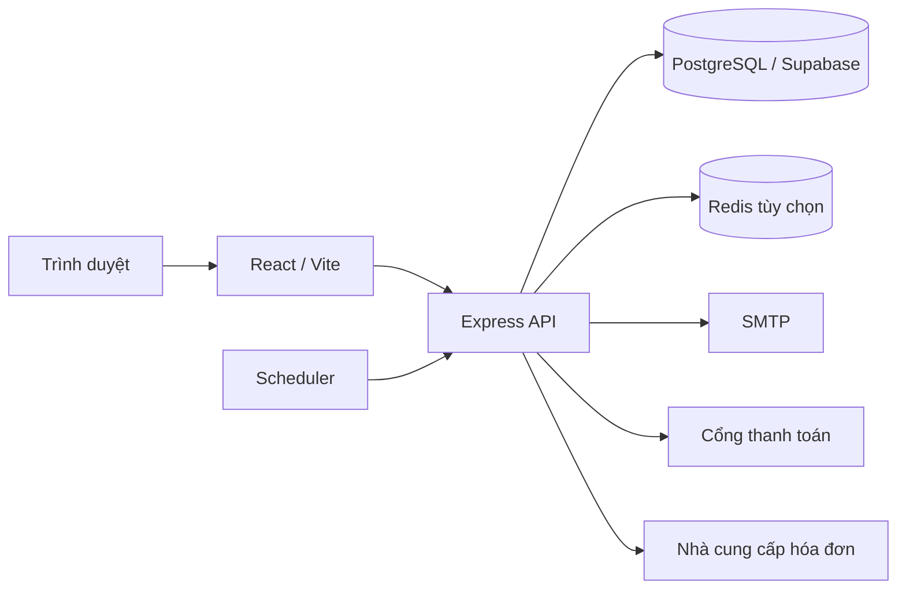

# SmartBus

**Hệ thống bán vé và quản lý vận hành xe buýt thông minh**

[](https://github.com/tamtran2k6zz/Project_Smart_Bus_Ticketing_System_ictu/actions/workflows/ci.yml)

[Ứng dụng](https://smart-bus-ticketing-system.vercel.app/) · [Báo lỗi](https://github.com/tamtran2k6zz/Project_Smart_Bus_Ticketing_System_ictu/issues) · [Tài liệu](#tài-liệu)

SmartBus số hóa quy trình tra cứu, đặt vé, thanh toán và soát vé xe buýt; đồng thời hỗ trợ nhà xe quản lý tuyến, lịch chạy, đội xe, nhân sự và doanh thu. Dự án sử dụng tiếng Việt, đơn vị tiền tệ VND và múi giờ `Asia/Ho_Chi_Minh`.

Được phát triển bởi **Nhóm 5 — N5 Innovators**, Trường Đại học Công nghệ Thông tin & Truyền thông, Đại học Thái Nguyên (ICTU), trong khuôn khổ Đồ án Thực tập Cơ sở 2026.


## Mục lục

- [Phạm vi sản phẩm](#phạm-vi-sản-phẩm)
- [Kiến trúc và công nghệ](#kiến-trúc-và-công-nghệ)
- [Khởi chạy](#khởi-chạy)
- [Cấu hình](#cấu-hình)
- [Kiểm thử](#kiểm-thử)
- [Triển khai và vận hành](#triển-khai-và-vận-hành)
- [Cấu trúc mã nguồn](#cấu-trúc-mã-nguồn)
- [Tài liệu](#tài-liệu)
- [Đóng góp và bảo mật](#đóng-góp-và-bảo-mật)

## Phạm vi sản phẩm

| Phân hệ                | Chức năng chính                                                                                                          |
| ---------------------- | ------------------------------------------------------------------------------------------------------------------------ |
| Đặt vé và vé điện tử   | Tìm chuyến theo hành trình/thời gian, chọn ghế, giữ chỗ 10 phút, phát hành QR, gửi yêu cầu hủy/đổi vé                    |
| Thanh toán và chứng từ | Adapter MoMo, VNPay, ZaloPay; thẻ ngân hàng qua VNPay; xác minh callback, hàng đợi hoàn tiền, hóa đơn và email vé        |
| Điều hành              | Quản lý tuyến/trạm/giá, đội xe, lịch theo tần suất, phân công tài xế/phụ xe, đổi giờ và hoàn tất chuyến quá giờ đến      |
| Hành trình và soát vé  | Nhận GPS, hiển thị độ mới của dữ liệu/ETA, đăng ký thông báo trạm, báo sự cố/trễ chuyến, quét QR và danh sách hành khách |
| Vé tháng và ưu đãi     | Mua/gia hạn vé tháng, duyệt đối tượng ưu tiên, chính sách giá và quản lý voucher                                         |
| Báo cáo và phân tích   | Doanh thu theo thời gian/tuyến/xe, tỷ lệ lấp đầy từng chuyến, xuất Excel/PDF, mật độ khách và dự báo nhu cầu tham khảo   |
| Quản trị và hỗ trợ     | Phân quyền tài khoản, nhật ký truy cập/thao tác, phản ánh và phản hồi, xác minh email và khôi phục mật khẩu              |

Các phân hệ tương ứng với **24 user story và 5 product goal**. Việc có chức năng và kiểm thử tự động chưa thay thế nghiệm thu tích hợp bên ngoài hoặc đo hiệu quả kinh doanh trên dữ liệu vận hành thực.

### Vai trò sử dụng

| Vai trò         | Mã          | Phạm vi chính                                      |
| --------------- | ----------- | -------------------------------------------------- |
| Hành khách      | `PASSENGER` | Đặt vé, vé tháng, hành trình và dữ liệu cá nhân    |
| Tài xế / phụ xe | `DRIVER`    | Chuyến được phân công, soát vé, vị trí và sự cố    |
| Điều hành       | `MANAGER`   | Vận hành, hỗ trợ, soát vé, duyệt ưu đãi và báo cáo |
| Tài chính       | `FINANCE`   | Báo cáo và khuyến mãi                              |
| Marketing       | `MARKETING` | Quản lý khuyến mãi                                 |
| Quản trị viên   | `ADMIN`     | Quản trị toàn hệ thống                             |

Backend xác thực JWT, kiểm tra vai trò hiện tại, quyền sở hữu dữ liệu và phân công chuyến. Quyền truy cập được kiểm tra tại API bên cạnh các guard trên giao diện.

## Kiến trúc và công nghệ



| Thành phần                     | Công nghệ                                                                                 |
| ------------------------------ | ----------------------------------------------------------------------------------------- |
| Frontend                       | React 19, TypeScript, Vite 8, React Router, TanStack Query, Zustand, React Hook Form, Zod |
| Giao diện và dữ liệu trực quan | CSS Modules, anime.js, Leaflet, Recharts, ExcelJS, jsPDF                                  |
| Backend                        | Express, TypeScript, node-postgres, JWT, bcrypt, Nodemailer, WebSocket                    |
| Lưu trữ                        | PostgreSQL trên Supabase; Redis tùy chọn                                                  |
| Kiểm thử                       | Jest, Vitest, Testing Library, Playwright, PGlite                                         |
| Triển khai                     | Vercel, Docker Compose, Nginx, GitHub Actions                                             |

Các thao tác đặt vé sử dụng transaction và khóa hàng PostgreSQL. Redis bổ sung khóa/cache cho các luồng có cấu hình sử dụng. Schema được quản lý bằng migration SQL; backend sử dụng trực tiếp `pg`.

## Khởi chạy

### Yêu cầu

- Node.js **22.12 trở lên** và npm; CI sử dụng Node.js 22.
- PostgreSQL/Supabase cho chế độ API thật.
- Các ví dụ CLI dưới đây dùng PowerShell; PowerShell 7 hỗ trợ nhập mật khẩu ẩn ở ví dụ tạo admin.

### Cài đặt dependency

```powershell
git clone https://github.com/tamtran2k6zz/Project_Smart_Bus_Ticketing_System_ictu.git
cd Project_Smart_Bus_Ticketing_System_ictu
npm ci
npm --prefix backend ci
npm --prefix frontend ci
```

### Phát triển với API và PostgreSQL

**1. Chuẩn bị cấu hình** cho checkout mới, từ thư mục gốc:

```powershell
Copy-Item .env.example backend/.env
Copy-Item frontend/.env.example frontend/.env.local
```

Điền cấu hình database, JWT và các dịch vụ cần sử dụng vào `backend/.env`. Backend nạp `.env` theo thư mục làm việc. Tạo JWT secret riêng thay cho giá trị mẫu:

```powershell
node -e "console.log(require('node:crypto').randomBytes(32).toString('base64'))"
```

Frontend dùng cấu hình:

```dotenv
VITE_APP_MODE=api
VITE_API_BASE_URL=/api/smartbus/v1
VITE_LEGACY_APP=false
```

**2. Áp dụng migration** và tạo admin, từ `backend/`:

```powershell
cd backend
npm run db:migrate
$env:ADMIN_EMAIL = 'admin@example.com'
$env:ADMIN_PASSWORD = Read-Host 'Mật khẩu quản trị, tối thiểu 12 ký tự' -MaskInput
npm run db:create-admin
Remove-Item Env:ADMIN_PASSWORD
Remove-Item Env:ADMIN_EMAIL
```

`-MaskInput` yêu cầu PowerShell 7. Migration tạo schema/vai trò; không tự tạo tài khoản demo hoặc dữ liệu vận hành. Script tạo admin không ghi đè mật khẩu của tài khoản đã tồn tại. Giữ nguyên các migration đã áp dụng; bổ sung migration mới khi thay đổi schema.

**3. Khởi chạy dịch vụ** trong hai terminal:

```powershell
# Terminal 1 — tại backend/
npm run start:express
```

```powershell
# Terminal 2 — tại thư mục gốc repository
npm --prefix frontend run dev
```

| Dịch vụ  | Địa chỉ                               |
| -------- | ------------------------------------- |
| Frontend | http://localhost:3000                 |
| API      | http://localhost:5000/api/smartbus/v1 |
| Health   | http://localhost:5000/api/health      |

Quản trị viên tạo tuyến, trạm, xe, lịch chạy và phân công nhân sự trước khi thử đặt vé. Hành khách cần xác minh email để thực hiện các nghiệp vụ yêu cầu xác minh.

Frontend cũng hỗ trợ `VITE_APP_MODE=demo` để chạy dữ liệu mô phỏng trong localStorage. Giao diện cũ được bật riêng bằng `VITE_LEGACY_APP=true`.

## Cấu hình

Danh sách đầy đủ nằm trong [cấu hình backend mẫu](.env.example) và [cấu hình frontend mẫu](frontend/.env.example).

| Nhóm              | Biến chính                                                                         | Mục đích                                                |
| ----------------- | ---------------------------------------------------------------------------------- | ------------------------------------------------------- |
| Database          | `DATABASE_URL`, `DIRECT_URL`, `DB_POOL_MAX`                                        | Kết nối runtime, migration và giới hạn pool             |
| Ứng dụng          | `NODE_ENV`, `PORT`, `JWT_SECRET`, `CORS_ORIGIN`                                    | Môi trường, xác thực và origin frontend                 |
| Email             | `SMTP_HOST`, `SMTP_PORT`, `SMTP_SECURE`, `SMTP_USER`, `SMTP_PASSWORD`, `SMTP_FROM` | Xác minh tài khoản, khôi phục mật khẩu, gửi vé/chứng từ |
| Liên kết frontend | `FRONTEND_PUBLIC_URL`                                                              | Origin nhận liên kết email; dùng HTTPS trên production  |
| Thanh toán        | `MOMO_*`, `VNPAY_*`, `ZALOPAY_*`                                                   | Merchant, chữ ký, callback và kết quả thanh toán        |
| Hóa đơn           | `INVOICE_API_URL`, `INVOICE_API_TOKEN`, `INVOICE_SELLER_NAME`                      | Adapter nhà cung cấp hóa đơn                            |
| Job và Redis      | `PAYMENT_CRON_SECRET` hoặc `CRON_SECRET`, `REDIS_URL`                              | Bảo vệ job định kỳ; khóa/cache tùy chọn                 |
| Frontend          | `VITE_APP_MODE`, `VITE_API_BASE_URL`, `VITE_LEGACY_APP`                            | Chế độ dữ liệu, API và giao diện                        |

Dùng session/direct connection cho migration; transaction pooler cổng `6543` dành cho runtime. Cấu hình chứng chỉ TLS theo môi trường triển khai và yêu cầu của nhà cung cấp.

Các biến `VITE_*` được đưa vào mã frontend và có thể đọc từ trình duyệt. Credential database, SMTP, merchant, JWT secret và file môi trường thật phải được quản lý riêng, không đưa vào Git.

## Kiểm thử

Từ thư mục gốc repository:

```powershell
npm --prefix backend run typecheck
npm run lint
npm test
npm run build
npm --prefix backend run test:postgres
npm --prefix backend run test:trip-cleanup
npm --prefix backend run test:serverless
npm --prefix frontend run test:e2e
```

Kiểm thử trình duyệt qua API sử dụng cấu hình riêng, yêu cầu API và dữ liệu thử nghiệm cô lập đã được khởi tạo:

```powershell
Push-Location frontend
npx playwright test --config playwright.demo.config.ts
Pop-Location
```

Playwright cần trình duyệt đã cài đặt; có thể chỉ định Chrome bằng biến `PLAYWRIGHT_EXECUTABLE_PATH`. Trên máy hạn chế tài nguyên, chạy frontend test với `npm --prefix frontend test -- --maxWorkers=1`.

Mốc kiểm chứng cục bộ ngày **14/10/2026**:

| Nhóm                   | Kết quả                      |
| ---------------------- | ---------------------------- |
| Backend unit           | 83 test / 12 suite đạt       |
| Frontend unit và theme | 85 Vitest và 8 test Node đạt |
| API / PostgreSQL       | 394 kiểm tra đạt             |
| E2E frontend           | 13 kịch bản đạt              |
| E2E qua API cô lập     | 3 kịch bản đạt               |

PGlite và provider giả lập giúp kiểm tra nghiệp vụ, migration, phân quyền và các tình huống lỗi. Kết quả này chưa thay thế kiểm thử tải trên PostgreSQL nhiều kết nối, giao dịch provider thật hoặc thiết bị GPS/camera thực.

## Triển khai và vận hành

### Vercel

Sử dụng thư mục gốc repository làm **Root Directory**. [vercel.json](vercel.json) cấu hình build backend/frontend, output `frontend/dist`, function `api/index.js` và SPA fallback.

- Đặt các biến backend ở môi trường triển khai; frontend/API cùng origin sử dụng `/api/smartbus/v1`.
- Dùng database riêng cho Preview và production; áp dụng migration trước khi triển khai mã phụ thuộc schema mới.
- Xác nhận `/api/health` trả HTTP `200` và database kết nối thành công sau triển khai.
- Cấu hình scheduler gọi `/api/v1/ticketing/release-expired` với Bearer job secret. Interval trong `server.ts` chỉ chạy trên server thường trực.
- Tracking/thông báo sử dụng polling HTTP trên frontend. WebSocket cần hạ tầng hỗ trợ kết nối thường trực.

### Docker Compose

[docker-compose.yml](docker-compose.yml) cung cấp frontend Nginx, backend và Redis. Database PostgreSQL được kết nối từ bên ngoài.

```powershell
# Tại thư mục gốc; điền các biến cần thiết vào .env trước khi chạy
Copy-Item .env.example .env
docker compose up --build -d
```

Đối chiếu các biến được truyền trong Compose khi bật SMTP hoặc tích hợp bổ sung; một số biến cần khai báo thêm bằng override hoặc cấu hình môi trường triển khai.

### Điều kiện nghiệm thu production

Cần hoàn tất nghiệm thu merchant/callback/hoàn tiền, hợp đồng API hóa đơn, nhận email thực, camera/GPS, scheduler, backup/khôi phục và kiểm thử tải. Rà soát TLS của các script quản trị/migration trước khi sử dụng trên dữ liệu thật. Các đề xuất tần suất và dự báo cần được đánh giá bằng dữ liệu vận hành cùng chỉ số sai số đã thống nhất.

## Cấu trúc mã nguồn

```text
.
├── api/                         Entrypoint serverless
├── backend/
│   ├── src/                     Express app, cấu hình, routes và services
│   └── scripts/                 Migration, công cụ quản trị, demo và kiểm tra API
├── frontend/
│   ├── src/
│   │   ├── features/            Các phân hệ nghiệp vụ
│   │   └── ...                  Trang, layout, component, service và trạng thái
│   ├── tests/                   Kiểm thử trình duyệt
│   └── public/                  Font, favicon và tài nguyên công khai
├── supabase/migrations/         Schema và lịch sử thay đổi PostgreSQL
├── docs/                        Kiến trúc, hướng dẫn và báo cáo
├── docker-compose.yml
├── vercel.json
└── package.json
```

Các lệnh npm của từng thành phần được định nghĩa trong [package root](package.json), [backend](backend/package.json) và [frontend](frontend/package.json).

## Tài liệu

Các liên kết dưới đây trỏ tới phiên bản tài liệu đã lưu cùng mã nguồn, để giữ ổn định khi vị trí file được tổ chức lại:

| Tài liệu                                                                                                                                                                                           | Nội dung                                                                |
| -------------------------------------------------------------------------------------------------------------------------------------------------------------------------------------------------- | ----------------------------------------------------------------------- |
| [Hướng dẫn demo](https://github.com/tamtran2k6zz/Project_Smart_Bus_Ticketing_System_ictu/blob/745108a0217267ee29cb65e88d94437d853f5f45/docs/DEMO_2026-10-13.md)                                    | Kịch bản 15 phút, tài khoản và dữ liệu mẫu                              |
| [Sơ đồ dữ liệu](https://github.com/tamtran2k6zz/Project_Smart_Bus_Ticketing_System_ictu/blob/745108a0217267ee29cb65e88d94437d853f5f45/docs/ERD_SMART_BUS_TICKETING_SYSTEM.md)                      | ERD nền và quan hệ nghiệp vụ                                            |
| [Khôi phục mật khẩu](https://github.com/tamtran2k6zz/Project_Smart_Bus_Ticketing_System_ictu/blob/745108a0217267ee29cb65e88d94437d853f5f45/docs/PASSWORD_RECOVERY_2026-10-13.md)                   | Email khôi phục, thời hạn liên kết và hủy phiên cũ                      |
| [Hoàn tất chuyến](https://github.com/tamtran2k6zz/Project_Smart_Bus_Ticketing_System_ictu/blob/745108a0217267ee29cb65e88d94437d853f5f45/docs/TRIP_CLEANUP_2026-10-13.md)                           | Điều kiện giờ đến, quyền truy cập và tính an toàn khi chạy lặp          |
| [Đánh giá chức năng ngày 12/10](https://github.com/tamtran2k6zz/Project_Smart_Bus_Ticketing_System_ictu/blob/745108a0217267ee29cb65e88d94437d853f5f45/docs/IMPLEMENTATION_READINESS_2026-10-12.md) | Đối chiếu user story/goal và giới hạn nghiệm thu tại thời điểm đánh giá |

Điểm vào API được định nghĩa tại [backend/src/app.ts](backend/src/app.ts); điều hướng giao diện chính tại [frontend/src/routes/AppRouter.tsx](frontend/src/routes/AppRouter.tsx).

## Đóng góp và bảo mật

1. Tạo nhánh từ phiên bản `main` mới nhất, mô tả rõ phạm vi thay đổi.
2. Bổ sung migration mới cho thay đổi dữ liệu; không chỉnh migration đã áp dụng.
3. Chạy các kiểm tra liên quan và cập nhật tài liệu/config mẫu khi thay đổi hành vi.
4. Gửi pull request kèm mục đích, cách kiểm tra và tác động triển khai.

Dùng Issues cho lỗi chức năng và đề xuất cải tiến. Với vấn đề bảo mật, liên hệ riêng người quản lý repository; không đăng credential, token, connection string hoặc dữ liệu cá nhân vào issue công khai.

Repository hiện chưa công bố tệp `LICENSE`. Thông tin nhóm phát triển: **N5 Innovators — ICTU, 2026**.
