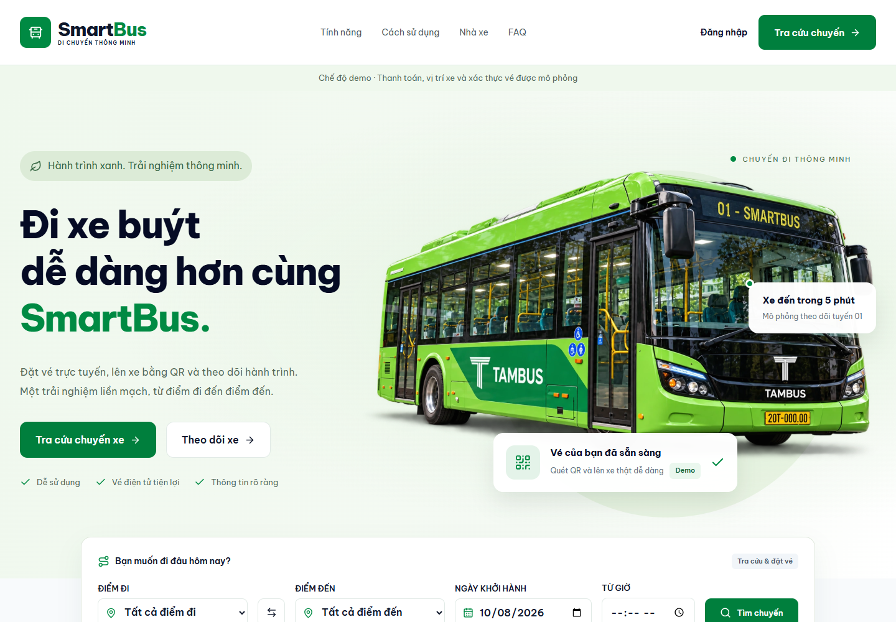
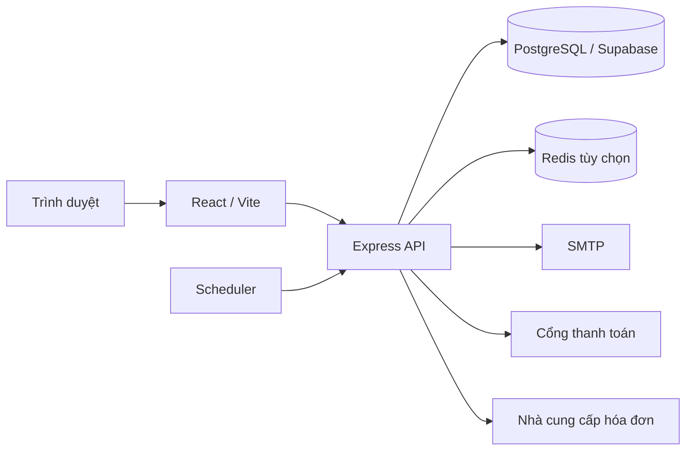
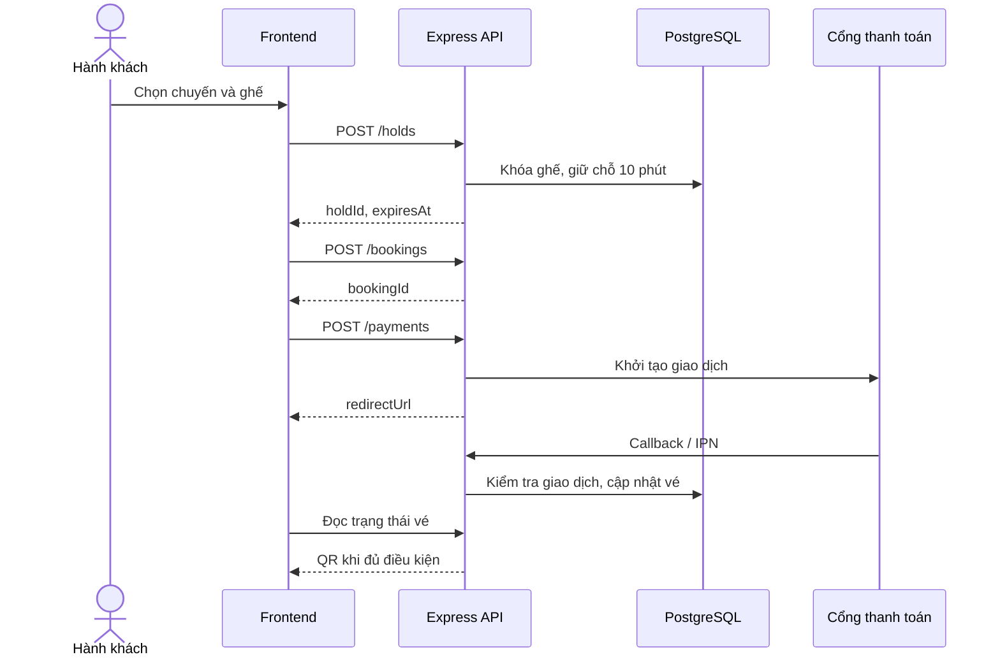

# SmartBus — Hệ thống bán vé xe buýt thông minh

**Đồ án Thực tập Cơ sở 2026 · Nhóm 5 — N5 Innovators**

**Trường Đại học Công nghệ Thông tin & Truyền thông — Đại học Thái Nguyên (ICTU).**

[](https://github.com/tamtran2k6zz/Project_Smart_Bus_Ticketing_System_ictu/actions/workflows/ci.yml)

[Ứng dụng](https://smart-bus-ticketing-system.vercel.app/) · [Báo lỗi](https://github.com/tamtran2k6zz/Project_Smart_Bus_Ticketing_System_ictu/issues) · [Tài liệu](#tài-liệu)

SmartBus là đồ án xây dựng ứng dụng web số hóa quy trình tra cứu, đặt vé, thanh toán và soát vé xe buýt; đồng thời hỗ trợ quản lý tuyến, lịch chạy, đội xe, nhân sự và doanh thu. Đồ án vận dụng kiến thức phân tích yêu cầu, thiết kế cơ sở dữ liệu, phát triển phần mềm và kiểm thử vào một bài toán vận tải công cộng. Giao diện sử dụng tiếng Việt, đơn vị tiền tệ VND và múi giờ `Asia/Ho_Chi_Minh`.



## Mục lục

- [Thông tin đồ án](#thông-tin-đồ-án)
- [Tầm nhìn, mục tiêu và phạm vi đồ án](#tầm-nhìn-mục-tiêu-và-phạm-vi-đồ-án)
- [Vai trò và phân quyền](#vai-trò-và-phân-quyền)
- [Kiến trúc và công nghệ](#kiến-trúc-và-công-nghệ)
- [Luồng nghiệp vụ chính](#luồng-nghiệp-vụ-chính)
- [Cơ sở dữ liệu và migration](#cơ-sở-dữ-liệu-và-migration)
- [Hướng dẫn cài đặt và chạy](#hướng-dẫn-cài-đặt-và-chạy)
- [Cấu hình](#cấu-hình)
- [Kiểm thử](#kiểm-thử)
- [Triển khai và vận hành](#triển-khai-và-vận-hành)
- [Kết quả, hạn chế và hướng phát triển](#kết-quả-hạn-chế-và-hướng-phát-triển)
- [Cấu trúc mã nguồn](#cấu-trúc-mã-nguồn)
- [Tài liệu](#tài-liệu)
- [Đội ngũ phát triển](#đội-ngũ-phát-triển)
- [Quy trình làm việc nhóm và bảo mật](#quy-trình-làm-việc-nhóm-và-bảo-mật)

## Thông tin đồ án

| Nội dung       | Thông tin                                                                      |
| -------------- | ------------------------------------------------------------------------------ |
| Tên đề tài     | Xây dựng hệ thống bán vé và quản lý vận hành xe buýt thông minh                |
| Học phần       | Đồ án Thực tập Cơ sở                                                           |
| Năm thực hiện  | 2026                                                                           |
| Nhóm thực hiện | Nhóm 5 — N5 Innovators                                                         |
| Đơn vị đào tạo | Trường Đại học Công nghệ Thông tin & Truyền thông — Đại học Thái Nguyên (ICTU) |

## Tầm nhìn, mục tiêu và phạm vi đồ án

### Bài toán và tầm nhìn

Việc bán vé, kiểm soát chỗ, phân công chuyến và tổng hợp doanh thu cần dữ liệu thống nhất giữa hành khách, tài xế và bộ phận điều hành. Đồ án lựa chọn bài toán này để phân tích yêu cầu, thiết kế cơ sở dữ liệu, xây dựng ứng dụng web và kiểm chứng các quy tắc nghiệp vụ.

**Tầm nhìn:** xây dựng hệ thống số hóa bán vé xe buýt, giúp hành khách tra cứu, đặt vé và theo dõi hành trình; đồng thời hỗ trợ nhà xe điều hành chuyến, kiểm soát doanh thu và nâng cao chất lượng phục vụ.

### Năm mục tiêu của đề tài

| Mục tiêu                             | Nội dung triển khai                                                           |
| ------------------------------------ | ----------------------------------------------------------------------------- |
| G1 — Số hóa bán vé và thanh toán     | Tra cứu, sơ đồ ghế, giữ chỗ, thanh toán trực tuyến và phát hành vé QR         |
| G2 — Hỗ trợ quản lý vận hành         | Quản lý tuyến/trạm/lịch/đội xe, phân công tài xế/phụ xe và soát vé            |
| G3 — Nâng cao trải nghiệm hành khách | Theo dõi vị trí xe, thông báo trạm, cập nhật sự cố và thay đổi chuyến         |
| G4 — Quản lý tài chính và ưu đãi     | Báo cáo doanh thu, vé lượt/vé tháng, hồ sơ ưu tiên và chương trình khuyến mãi |
| G5 — Phân tích dữ liệu vận tải       | Mật độ hành khách theo giờ/trạm, đề xuất tần suất và dự báo nhu cầu tham khảo |

### Phạm vi 24 user story

| Nhóm nghiệp vụ                 | User story | Nội dung                                                    |
| ------------------------------ | ---------- | ----------------------------------------------------------- |
| Quản lý đặt vé và vé điện tử   | US 01–05   | Tra cứu, chọn ghế, giữ chỗ 10 phút, QR, hủy/đổi vé          |
| Thanh toán và tích hợp         | US 06–08   | Cổng thanh toán, hóa đơn qua email và hoàn tiền             |
| Định vị và theo dõi hành trình | US 09–11   | GPS, thông báo trạm, báo sự cố/trễ chuyến                   |
| Quản lý vận hành               | US 12–15   | Tuyến/trạm/giá, lịch theo tần suất, điều xe/tổ lái, soát QR |
| Vé tháng và khuyến mãi         | US 16–18   | Đăng ký/gia hạn vé tháng, duyệt ưu đãi và voucher           |
| Báo cáo và thống kê            | US 19–21   | Doanh thu, lấp đầy từng chuyến, xuất Excel/PDF              |
| Quản trị và hỗ trợ             | US 22–24   | Tài khoản/phân quyền, nhật ký và phản ánh hành khách        |

### Các phân hệ hiện có

| Phân hệ                | Chức năng chính                                                                                                                          |
| ---------------------- | ---------------------------------------------------------------------------------------------------------------------------------------- |
| Đặt vé và vé điện tử   | Tìm chuyến theo hành trình/thời gian, chọn ghế, giữ chỗ 10 phút, phát hành QR, gửi yêu cầu hủy/đổi vé                                    |
| Thanh toán và chứng từ | Adapter MoMo, VNPay, ZaloPay; ví điện tử người dùng, hoàn tiền tức thì, hóa đơn và email vé                                              |
| Điều hành              | Quản lý tuyến/trạm/giá, đội xe, lịch theo tần suất, phân công tài xế/phụ xe, đổi giờ và hoàn tất chuyến quá giờ đến                      |
| Hành trình và soát vé  | Nhận GPS, hiển thị độ mới của dữ liệu/ETA, đăng ký thông báo trạm, báo sự cố/trễ chuyến, quét QR và danh sách hành khách                 |
| Vé tháng và ưu đãi     | Mua/gia hạn vé tháng, duyệt đối tượng ưu tiên, chính sách giá và quản lý voucher                                                         |
| Báo cáo và phân tích   | Doanh thu theo thời gian/tuyến/xe, tỷ lệ lấp đầy từng chuyến, xuất Excel/PDF, mật độ khách và dự báo nhu cầu tham khảo                   |
| Quản trị và hỗ trợ     | Phân quyền tài khoản, quản lý yêu cầu hủy/đổi vé, duyệt rút tiền về ngân hàng, nhật ký truy cập/thao tác, phản ánh và khôi phục mật khẩu |

Các phân hệ tương ứng với **24 user story và 5 product goal**. Việc có chức năng và kiểm thử tự động chưa thay thế nghiệm thu tích hợp bên ngoài hoặc đo hiệu quả kinh doanh trên dữ liệu vận hành thực.

## Vai trò và phân quyền

| Vai trò         | Mã          | Phạm vi chính                                      |
| --------------- | ----------- | -------------------------------------------------- |
| Hành khách      | `PASSENGER` | Đặt vé, vé tháng, hành trình và dữ liệu cá nhân    |
| Tài xế / phụ xe | `DRIVER`    | Chuyến được phân công, soát vé, vị trí và sự cố    |
| Điều hành       | `MANAGER`   | Vận hành, hỗ trợ, soát vé, duyệt ưu đãi và báo cáo |
| Tài chính       | `FINANCE`   | Báo cáo và khuyến mãi                              |
| Marketing       | `MARKETING` | Quản lý khuyến mãi                                 |
| Quản trị viên   | `ADMIN`     | Quản trị toàn hệ thống                             |

Backend xác thực JWT, kiểm tra vai trò hiện tại, quyền sở hữu dữ liệu và phân công chuyến. Quyền truy cập được kiểm tra tại API bên cạnh các guard trên giao diện.

## Kiến trúc và công nghệ



| Thành phần                     | Công nghệ                                                                                 |
| ------------------------------ | ----------------------------------------------------------------------------------------- |
| Frontend                       | React 19, TypeScript, Vite 8, React Router, TanStack Query, Zustand, React Hook Form, Zod |
| Giao diện và dữ liệu trực quan | CSS Modules, anime.js, Leaflet, Recharts, ExcelJS, jsPDF                                  |
| Backend                        | Express, TypeScript, node-postgres, JWT, bcrypt, Nodemailer, WebSocket                    |
| Lưu trữ                        | PostgreSQL trên Supabase; Redis tùy chọn                                                  |
| Kiểm thử                       | Jest, Vitest, Testing Library, Playwright, PGlite                                         |
| Triển khai                     | Vercel, Docker Compose, Nginx, GitHub Actions                                             |

Các thao tác đặt vé sử dụng transaction và khóa hàng PostgreSQL. Redis bổ sung khóa/cache cho các luồng có cấu hình sử dụng. Schema được quản lý bằng migration SQL; backend sử dụng trực tiếp `pg` với hệ thống interface TypeScript tường minh (strict domain interfaces), bảo mật HMAC/timingSafeEqual và chuẩn hóa xử lý lỗi đồng bộ.

## Luồng nghiệp vụ chính

### Đặt vé, thanh toán và nhận QR



Giá và thời hạn giữ chỗ do backend xác định; tải lại trang không gia hạn. Callback phải khớp chữ ký, số tiền và giao dịch. Tham số trên URL trả về không tự xác nhận thanh toán. Yêu cầu lặp và giao dịch đến muộn được xử lý để tránh phát hành trùng vé.

### Xác minh, hủy/đổi và soát vé

- Hành khách đăng ký bằng email, nhận liên kết xác minh và hoàn tất xác minh trước các thao tác yêu cầu quyền này. Khôi phục mật khẩu dùng liên kết có hạn, dùng một lần; đổi mật khẩu làm mất hiệu lực phiên cũ.
- Yêu cầu hủy/đổi được xét theo điều kiện vé và thời gian trước khởi hành. Backend quản lý việc đổi chỗ, trạng thái vé và hoàn tiền; thông tin ngân hàng nhận hoàn có thể được cung cấp trong yêu cầu hủy.
- Người soát cần đúng quyền và phân công chuyến. Vé chưa thanh toán, bị hủy hoặc QR không còn hợp lệ bị từ chối; quét lặp không tạo thêm lần lên xe.
- Chuyến chờ chạy hoặc đang chạy được hoàn tất khi đã qua giờ đến dự kiến. Những chuyến chưa tới giờ kết thúc được giữ nguyên.

### Vị trí và thông báo

Giao diện nhận vị trí/ETA qua HTTP polling, hiển thị thời điểm cập nhật và tình trạng dữ liệu. Backend nhận cập nhật GPS từ người hoặc nguồn có quyền; dữ liệu thiếu/cũ không được coi là tín hiệu GPS trực tiếp hợp lệ. WebSocket chỉ hoạt động trên hạ tầng hỗ trợ kết nối thường trực.

## Cơ sở dữ liệu và migration

Chức năng **Giải phóng chuyến hoàn thành** đưa tất cả chuyến đã hoàn thành sang lưu trữ và ra khỏi danh sách vận hành, đồng thời giữ lịch sử vé, xe/tổ lái và doanh thu. Xem [quy tắc và migration lưu trữ chuyến](docs/TRIP_ARCHIVE.md).

Nguồn schema áp dụng là **[supabase/migrations/](supabase/migrations/)**:

| Nhóm               | Bảng tiêu biểu                                                                                                   |
| ------------------ | ---------------------------------------------------------------------------------------------------------------- |
| Tài khoản          | `roles`, `users`, `staff_profiles`                                                                               |
| Vận hành           | `routes`, `bus_stops`, `route_stops`, `buses`, `seats`, `fares`, `trips`, `trip_seats`                           |
| Vé / thanh toán    | `ui_holds`, `ui_bookings`, `tickets`, `payment_transactions`, `ticket_requests`, `vouchers`, `user_wallets`      |
| Vị trí / tương tác | `trip_locations`, `trip_subscriptions`, `incidents`, `feedbacks`, `support_requests`, `eligibility_applications` |
| Audit / gửi vé     | `audit_events`, `ticket_email_deliveries` và các bảng validation/notification trong migration Sprint 3           |

Các migration bổ sung quản lý `monthly_passes`, `pass_orders`, `pass_checkins`, `fare_policies`, `refund_jobs`, `electronic_invoices`, đơn ZaloPay, `user_wallets` (ví điện tử) và các trường khôi phục mật khẩu/thông tin ngân hàng.

Migration runner:

- Ưu tiên `DIRECT_URL`, từ chối cổng Transaction pooler `6543`.
- Đọc SQL theo thứ tự tên, áp dụng trong transaction với advisory lock.
- Lưu checksum tại `smartbus_private.migrations`; từ chối file đã áp dụng bị sửa.
- Đồng bộ `supabase_migrations.schema_migrations` nếu bảng lịch sử này tồn tại.
- Chạy lại được với migration không thay đổi; không tự xóa bảng/dữ liệu để hòa giải schema.

Đổi schema bằng **migration mới**, kiểm thử trước khi áp dụng database dùng chung. Nguồn áp dụng chuẩn là thư mục `supabase/migrations`; không dùng bản SQL tham chiếu để thay runner. Truy cập ứng dụng đi qua Express/`pg`; custom JWT không phải Supabase Auth JWT. Migration bật RLS/hạn chế truy cập trực tiếp cho `anon`/`authenticated` của Data API.

[Sơ đồ ERD](https://github.com/tamtran2k6zz/Project_Smart_Bus_Ticketing_System_ictu/blob/745108a0217267ee29cb65e88d94437d853f5f45/docs/ERD_SMART_BUS_TICKETING_SYSTEM.md) mô tả mô hình nền; migration bổ sung là nguồn đối chiếu cho bảng mới.

## Hướng dẫn cài đặt và chạy

### Yêu cầu

- Node.js **22.12 trở lên** và npm; CI sử dụng Node.js 22.
- PostgreSQL/Supabase cho chế độ API thật.
- Các ví dụ CLI dưới đây dùng PowerShell; PowerShell 7 hỗ trợ nhập mật khẩu ẩn ở ví dụ tạo admin.

### Cài đặt dependency

```powershell
git clone https://github.com/tamtran2k6zz/Project_Smart_Bus_Ticketing_System_ictu.git
cd Project_Smart_Bus_Ticketing_System_ictu
npm ci
npm --prefix backend ci
npm --prefix frontend ci
```

### Phát triển với API và PostgreSQL

**1. Chuẩn bị cấu hình** cho checkout mới, từ thư mục gốc:

```powershell
Copy-Item .env.example backend/.env
Copy-Item frontend/.env.example frontend/.env.local
```

Điền cấu hình database, JWT và các dịch vụ cần sử dụng vào `backend/.env`. Backend nạp `.env` theo thư mục làm việc. Tạo JWT secret riêng thay cho giá trị mẫu:

```powershell
node -e "console.log(require('node:crypto').randomBytes(32).toString('base64'))"
```

Frontend dùng cấu hình:

```dotenv
VITE_APP_MODE=api
VITE_API_BASE_URL=/api/smartbus/v1
VITE_LEGACY_APP=false
```

**2. Áp dụng migration** và tạo admin, từ `backend/`:

```powershell
cd backend
npm run db:migrate
$env:ADMIN_EMAIL = 'admin@example.com'
$env:ADMIN_PASSWORD = Read-Host 'Mật khẩu quản trị, tối thiểu 12 ký tự' -MaskInput
npm run db:create-admin
Remove-Item Env:ADMIN_PASSWORD
Remove-Item Env:ADMIN_EMAIL
```

`-MaskInput` yêu cầu PowerShell 7. Migration tạo schema/vai trò; không tự tạo tài khoản demo hoặc dữ liệu vận hành. Script tạo admin không ghi đè mật khẩu của tài khoản đã tồn tại. Giữ nguyên các migration đã áp dụng; bổ sung migration mới khi thay đổi schema.

**3. Khởi chạy dịch vụ** trong hai terminal:

```powershell
# Terminal 1 — tại backend/
npm run start:express
```

```powershell
# Terminal 2 — tại thư mục gốc repository
npm --prefix frontend run dev
```

| Dịch vụ  | Địa chỉ                               |
| -------- | ------------------------------------- |
| Frontend | http://localhost:3000                 |
| API      | http://localhost:5000/api/smartbus/v1 |
| Health   | http://localhost:5000/api/health      |

Quản trị viên tạo tuyến, trạm, xe, lịch chạy và phân công nhân sự trước khi thử đặt vé. Hành khách cần xác minh email để thực hiện các nghiệp vụ yêu cầu xác minh.

Frontend cũng hỗ trợ `VITE_APP_MODE=demo` để chạy dữ liệu mô phỏng trong localStorage. Giao diện cũ được bật riêng bằng `VITE_LEGACY_APP=true`.

## Cấu hình

Phân hệ **Ví SmartBus** hỗ trợ nhận hoàn tiền, nạp qua cổng thanh toán, rút ngân hàng do tài chính duyệt thủ công và tự động gia hạn vé tháng bằng số dư ví. Xem [hướng dẫn sử dụng, migration và lịch gia hạn](docs/WALLET.md).

Danh sách đầy đủ nằm trong [cấu hình backend mẫu](.env.example) và [cấu hình frontend mẫu](frontend/.env.example).

| Nhóm              | Biến chính                                                                         | Mục đích                                                |
| ----------------- | ---------------------------------------------------------------------------------- | ------------------------------------------------------- |
| Database          | `DATABASE_URL`, `DIRECT_URL`, `DB_POOL_MAX`                                        | Kết nối runtime, migration và giới hạn pool             |
| Ứng dụng          | `NODE_ENV`, `PORT`, `JWT_SECRET`, `CORS_ORIGIN`                                    | Môi trường, xác thực và origin frontend                 |
| Email             | `SMTP_HOST`, `SMTP_PORT`, `SMTP_SECURE`, `SMTP_USER`, `SMTP_PASSWORD`, `SMTP_FROM` | Xác minh tài khoản, khôi phục mật khẩu, gửi vé/chứng từ |
| Liên kết frontend | `FRONTEND_PUBLIC_URL`                                                              | Origin nhận liên kết email; dùng HTTPS trên production  |
| Thanh toán        | `MOMO_*`, `VNPAY_*`, `ZALOPAY_*`                                                   | Merchant, chữ ký, callback và kết quả thanh toán        |
| Hóa đơn           | `INVOICE_API_URL`, `INVOICE_API_TOKEN`, `INVOICE_SELLER_NAME`                      | Adapter nhà cung cấp hóa đơn                            |
| Job và Redis      | `PAYMENT_CRON_SECRET` hoặc `CRON_SECRET`, `REDIS_URL`                              | Bảo vệ job định kỳ; khóa/cache tùy chọn                 |
| Frontend          | `VITE_APP_MODE`, `VITE_API_BASE_URL`, `VITE_LEGACY_APP`                            | Chế độ dữ liệu, API và giao diện                        |

Dùng session/direct connection cho migration; transaction pooler cổng `6543` dành cho runtime. Cấu hình chứng chỉ TLS theo môi trường triển khai và yêu cầu của nhà cung cấp.

Các biến `VITE_*` được đưa vào mã frontend và có thể đọc từ trình duyệt. Credential database, SMTP, merchant, JWT secret và file môi trường thật phải được quản lý riêng, không đưa vào Git.

## Kiểm thử

Từ thư mục gốc repository:

```powershell
npm --prefix backend run typecheck
npm run lint
npm test
npm run build
npm --prefix backend run test:postgres
npm --prefix backend run test:trip-cleanup
npm --prefix backend run test:serverless
npm --prefix frontend run test:e2e
```

Kiểm thử trình duyệt qua API sử dụng cấu hình riêng, yêu cầu API và dữ liệu thử nghiệm cô lập đã được khởi tạo:

```powershell
Push-Location frontend
npx playwright test --config playwright.demo.config.ts
Pop-Location
```

Playwright cần trình duyệt đã cài đặt; có thể chỉ định Chrome bằng biến `PLAYWRIGHT_EXECUTABLE_PATH`. Trên máy hạn chế tài nguyên, chạy frontend test với `npm --prefix frontend test -- --maxWorkers=1`.

Mốc kiểm chứng cục bộ ngày **14/10/2026**:

| Nhóm                   | Kết quả                      |
| ---------------------- | ---------------------------- |
| Backend unit           | 83 test / 12 suite đạt       |
| Frontend unit và theme | 85 Vitest và 8 test Node đạt |
| API / PostgreSQL       | 394 kiểm tra đạt             |
| E2E frontend           | 13 kịch bản đạt              |
| E2E qua API cô lập     | 3 kịch bản đạt               |

PGlite và provider giả lập giúp kiểm tra nghiệp vụ, migration, phân quyền và các tình huống lỗi. Kết quả này chưa thay thế kiểm thử tải trên PostgreSQL nhiều kết nối, giao dịch provider thật hoặc thiết bị GPS/camera thực.

## Triển khai và vận hành

### Vercel

Sử dụng thư mục gốc repository làm **Root Directory**. [vercel.json](vercel.json) cấu hình build backend/frontend, output `frontend/dist`, function `api/index.js` và SPA fallback.

- Đặt các biến backend ở môi trường triển khai; frontend/API cùng origin sử dụng `/api/smartbus/v1`.
- Dùng database riêng cho Preview và production; áp dụng migration trước khi triển khai mã phụ thuộc schema mới.
- Xác nhận `/api/health` trả HTTP `200` và database kết nối thành công sau triển khai.
- Cấu hình scheduler gọi `/api/v1/ticketing/release-expired` với Bearer job secret. Interval trong `server.ts` chỉ chạy trên server thường trực.
- Tracking/thông báo sử dụng polling HTTP trên frontend. WebSocket cần hạ tầng hỗ trợ kết nối thường trực.

### Docker Compose

[docker-compose.yml](docker-compose.yml) cung cấp frontend Nginx, backend và Redis. Database PostgreSQL được kết nối từ bên ngoài.

```powershell
# Tại thư mục gốc; điền các biến cần thiết vào .env trước khi chạy
Copy-Item .env.example .env
docker compose up --build -d
```

Đối chiếu các biến được truyền trong Compose khi bật SMTP hoặc tích hợp bổ sung; một số biến cần khai báo thêm bằng override hoặc cấu hình môi trường triển khai.

### Điều kiện nghiệm thu production

Cần hoàn tất nghiệm thu merchant/callback/hoàn tiền, hợp đồng API hóa đơn, nhận email thực, camera/GPS, scheduler, backup/khôi phục và kiểm thử tải. Rà soát TLS của các script quản trị/migration trước khi sử dụng trên dữ liệu thật. Các đề xuất tần suất và dự báo cần được đánh giá bằng dữ liệu vận hành cùng chỉ số sai số đã thống nhất.

## Kết quả, hạn chế và hướng phát triển

### Kết quả đạt được trong phạm vi đồ án

Đồ án đã xây dựng các phân hệ tương ứng với 24 user story, kết nối giao diện với Express/PostgreSQL và có kiểm thử nghiệp vụ xuyên suốt. Các kết quả kiểm thử được tổng hợp ở mục [Kiểm thử](#kiểm-thử). Dữ liệu và chức năng phân tích hỗ trợ cả năm mục tiêu đã đề ra; chưa có số liệu vận hành để khẳng định các mục tiêu kinh doanh đã đạt.

### Hạn chế

- Merchant, callback, hoàn tiền và nhà cung cấp hóa đơn cần nghiệm thu thực tế. Chứng từ mô phỏng hoặc file PDF tự xuất không thay thế hóa đơn thuế từ nhà cung cấp.
- GPS, camera và thông báo cần kiểm tra trên thiết bị/mạng thực. Chức năng soát vé hiện là ứng dụng web responsive, chưa có ứng dụng native Android/iOS riêng.
- PGlite và provider giả lập chưa thay thế bài kiểm tra tải, nhiều kết nối PostgreSQL server và vận hành liên tục.
- Dự báo hiện là thống kê tham khảo; chưa có dữ liệu lịch sử đủ lớn để đánh giá sai số và hiệu quả tối ưu tần suất.
- Cần tiếp tục rà soát TLS của công cụ migration/quản trị, cấu hình scheduler và quy trình backup/khôi phục trước khi vận hành trên dữ liệu thật.

### Hướng phát triển

1. Nghiệm thu dịch vụ thanh toán, hóa đơn và hoàn tiền với nhà cung cấp cụ thể.
2. Thử GPS/camera trên điện thoại, đo độ trễ cập nhật vị trí và thông báo trạm.
3. Kiểm thử tải/xung đột nhiều kết nối, đối soát dữ liệu và kiểm tra phục hồi sau sự cố.
4. Đánh giá mô hình dự báo trên dữ liệu thực, xác định chỉ số sai số và hiệu quả điều chỉnh chuyến.
5. Tiếp tục tách nghiệp vụ backend thành module và chuẩn hóa tài liệu, quy trình phát triển của nhóm.

### Cải tiến kỹ thuật gần đây (Tháng 10/2026)
- **Type Safety & Strict Interfaces**: Chuẩn hóa toàn bộ các dịch vụ cốt lõi (như `monthly-pass.service.ts`, `schedule.service.ts`) bằng các interface TypeScript tường minh (`MonthlyPassRecord`, `PassOrderRecord`, `ScheduleConfig`), loại bỏ các kiểu `any` lỏng lẻo.
- **Bảo mật & Đồng thời**: Tăng cường bảo mật xác thực QR vé tháng với HMAC SHA-256 và `timingSafeEqual`, kết hợp giao dịch PostgreSQL với row-level locking (`FOR UPDATE`) chống tranh chấp ghế hiệu quả.

## Cấu trúc mã nguồn

```text
.
├── api/                         Entrypoint serverless
├── backend/
│   ├── src/                     Express app, cấu hình, routes và services
│   └── scripts/                 Migration, công cụ quản trị, demo và kiểm tra API
├── frontend/
│   ├── src/
│   │   ├── features/            Các phân hệ nghiệp vụ
│   │   └── ...                  Trang, layout, component, service và trạng thái
│   ├── tests/                   Kiểm thử trình duyệt
│   └── public/                  Font, favicon và tài nguyên công khai
├── supabase/migrations/         Schema và lịch sử thay đổi PostgreSQL
├── docs/                        Kiến trúc, hướng dẫn và báo cáo
├── docker-compose.yml
├── vercel.json
└── package.json
```

Các lệnh npm của từng thành phần được định nghĩa trong [package root](package.json), [backend](backend/package.json) và [frontend](frontend/package.json).

## Tài liệu

Các liên kết dưới đây trỏ tới phiên bản tài liệu đã lưu cùng mã nguồn, để giữ ổn định khi vị trí file được tổ chức lại:

| Tài liệu                                                                                                                                                                                           | Nội dung                                                                |
| -------------------------------------------------------------------------------------------------------------------------------------------------------------------------------------------------- | ----------------------------------------------------------------------- |
| [Hướng dẫn demo](https://github.com/tamtran2k6zz/Project_Smart_Bus_Ticketing_System_ictu/blob/745108a0217267ee29cb65e88d94437d853f5f45/docs/DEMO_2026-10-13.md)                                    | Kịch bản 15 phút, tài khoản và dữ liệu mẫu                              |
| [Sơ đồ dữ liệu](https://github.com/tamtran2k6zz/Project_Smart_Bus_Ticketing_System_ictu/blob/745108a0217267ee29cb65e88d94437d853f5f45/docs/ERD_SMART_BUS_TICKETING_SYSTEM.md)                      | ERD nền và quan hệ nghiệp vụ                                            |
| [Khôi phục mật khẩu](https://github.com/tamtran2k6zz/Project_Smart_Bus_Ticketing_System_ictu/blob/745108a0217267ee29cb65e88d94437d853f5f45/docs/PASSWORD_RECOVERY_2026-10-13.md)                   | Email khôi phục, thời hạn liên kết và hủy phiên cũ                      |
| [Hoàn tất chuyến](https://github.com/tamtran2k6zz/Project_Smart_Bus_Ticketing_System_ictu/blob/745108a0217267ee29cb65e88d94437d853f5f45/docs/TRIP_CLEANUP_2026-10-13.md)                           | Điều kiện giờ đến, quyền truy cập và tính an toàn khi chạy lặp          |
| [Đánh giá chức năng ngày 12/10](https://github.com/tamtran2k6zz/Project_Smart_Bus_Ticketing_System_ictu/blob/745108a0217267ee29cb65e88d94437d853f5f45/docs/IMPLEMENTATION_READINESS_2026-10-12.md) | Đối chiếu user story/goal và giới hạn nghiệm thu tại thời điểm đánh giá |

Điểm vào API được định nghĩa tại [backend/src/app.ts](backend/src/app.ts); điều hướng giao diện chính tại [frontend/src/routes/AppRouter.tsx](frontend/src/routes/AppRouter.tsx).

Tài liệu phục vụ học phần tại commit tham chiếu:

- [Báo cáo Sprint 1 — Word](https://github.com/tamtran2k6zz/Project_Smart_Bus_Ticketing_System_ictu/blob/745108a0217267ee29cb65e88d94437d853f5f45/docs/Bao_Cao_Sprint_1_Smart_Bus_Ticketing_System.docx).
- [Slide thuyết trình Sprint 1 — PowerPoint](https://github.com/tamtran2k6zz/Project_Smart_Bus_Ticketing_System_ictu/blob/745108a0217267ee29cb65e88d94437d853f5f45/docs/Slide_Thuyet_Trinh_Sprint_1_Smart_Bus.pptx).

Kịch bản demo được giữ như tài liệu lịch sử. Hai script khởi động/dừng buổi demo đã được gỡ sau khi báo cáo kết thúc.

## Đội ngũ phát triển

| STT | Họ và tên              | Vai trò                  | Phân hệ phụ trách chính                           |
| :-: | ---------------------- | ------------------------ | ------------------------------------------------- |
|  1  | **Trần Đặng Công Tâm** | Scrum Master kiêm Leader | Quản lý dự án, Sprint, Cloud/Docker, review PR    |
|  2  | **Nguyễn Hoàng Đức**   | Frontend Developer       | Layout Auth, AuthContext, đăng nhập, RBAC         |
|  3  | **Hà Quang Vinh**      | Frontend Developer       | Quản trị tuyến, sắp xếp trạm kéo thả              |
|  4  | **Triệu Văn Thiệp**    | Frontend Developer       | Trang chủ, tra cứu tuyến, kết quả tìm kiếm        |
|  5  | **La Công Tuấn**       | Backend Developer        | Kiến trúc API, đặt vé, sơ đồ ghế, QR              |
|  6  | **Tào Hoàng Minh Vũ**  | Backend Developer        | PostgreSQL, migration Supabase, UTF-8             |
|  7  | **Nguyễn Minh Đức**    | Backend Developer        | API tìm chuyến, tối ưu truy vấn                   |
|  8  | **Mạch Thị Ngọc Ánh**  | Quality Assurance (QA)   | Test case, chất lượng phần mềm, soát vé QR        |
|  9  | **Đinh Hữu Phúc**      | Quality Assurance (QA)   | Kiểm thử chức năng, API và UI                     |
| 10  | **Hoàng Quốc Toản**    | Quality Assurance (QA)   | Hiệu năng, bảo mật, nghiệm thu Definition of Done |

## Quy trình làm việc nhóm và bảo mật

1. Tạo nhánh từ phiên bản `main` mới nhất, mô tả rõ phạm vi thay đổi.
2. Bổ sung migration mới cho thay đổi dữ liệu; không chỉnh migration đã áp dụng.
3. Chạy các kiểm tra liên quan và cập nhật tài liệu/config mẫu khi thay đổi hành vi.
4. Gửi pull request kèm mục đích, cách kiểm tra và tác động triển khai.

Dùng Issues cho lỗi chức năng và đề xuất cải tiến. Với vấn đề bảo mật, liên hệ riêng người quản lý repository; không đăng credential, token, connection string hoặc dữ liệu cá nhân vào issue công khai.

Repository hiện chưa công bố tệp `LICENSE`.

**Đồ án Thực tập Cơ sở 2026 · Nhóm 5 — N5 Innovators**

Trường Đại học Công nghệ Thông tin & Truyền thông — Đại học Thái Nguyên (ICTU).
