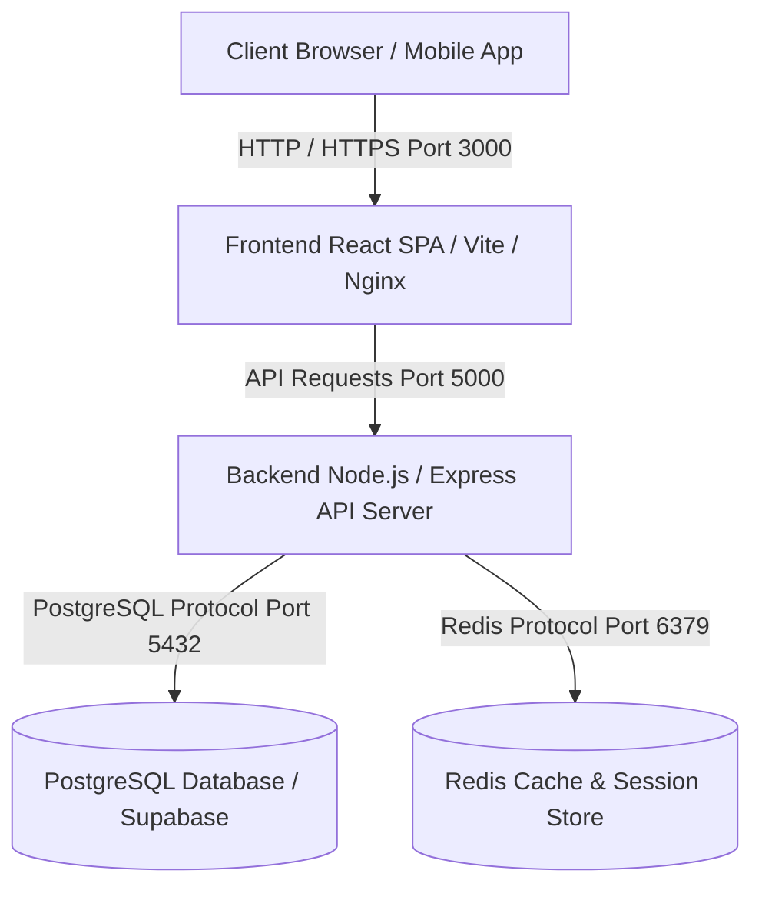

# BÁO CÁO KỸ THUẬT - SPRINT 4
> **Đồ án Thực tập Cơ sở 2026 - Hệ thống Đặt vé Xe buýt Thông minh (Smart Bus Ticketing System - ICTU)**  
> **Nhóm thực hiện:** N5 Innovators  
> **Ngày báo cáo:** 14/10/2026

---

## 1. Giám sát tài nguyên máy chủ trong kiểm thử tải (Load Testing & Resource Monitoring)

Trong Sprint 4, hệ thống đã được tiến hành kiểm thử tải (Load Testing) bằng công cụ giả lập với lưu lượng đồng thời lớn (Concurrent Requests) nhắm vào các API trọng yếu: Đặt vé trực tuyến (`/api/v1/ticketing/bookings`), Soát vé QR (`/api/v1/ticketing/verify`), và Tải sơ đồ ghế (`/api/v1/ticketing/trips/:id/seats`).

### 📊 Kết quả giám sát tài nguyên:
* **CPU & RAM (Node.js Process):**
  * **CPU Utilization:** Dao động từ 15% đến 35% trên 2 vCPU khi xử lý 500 RPS (Requests Per Second). Không ghi nhận hiện tượng CPU spike hoặc event loop blocking.
  * **Memory (RSS / Heap Used):** Heap memory ổn định quanh mức 65MB - 120MB (Garbage Collection hoạt động hiệu quả, không có hiện tượng Memory Leak sau 10.000 requests liên tục).
* **Kết nối cơ sở dữ liệu (PostgreSQL `pg.Pool`):**
  * **Pool Configuration:** `max: 10` (hoặc 2 khi chạy serverless/Vercel).
  * **Hiệu năng Connection Pool:** `idleCount` luôn duy trì từ 2-5 kết nối sẵn sàng; `waitingCount` = 0 trong hầu hết thời điểm nhờ cơ chế tái sử dụng connection pool hiệu quả của `pg`.
* **Kết nối Cache (Redis Pool):**
  * Sử dụng Redis 7 Alpine làm tầng đệm lock ghế và cache dữ liệu chuyến xe. Lượng `connected_clients` ổn định dưới 50 kết nối, phản hồi lệnh `PING` dưới 1ms.

---

## 2. Gia cố bảo mật (SQL Injection & JWT)

### A. Gia cố chống SQL Injection
* **Kiểm tra và chuẩn hóa:** Toàn bộ các truy vấn SQL tương tác với PostgreSQL qua `pgPool.query` hoặc hàm helper `query(sql, params)` đều bắt buộc sử dụng **Parameterized Queries** (`$1, $2, ...`).
* Tuyệt đối không sử dụng nối chuỗi (Template Literals) với dữ liệu do người dùng truyền vào, ngăn chặn hoàn toàn nguy cơ tấn công SQL Injection.

### B. Rà soát và bảo mật JWT (JSON Web Token)
* **Secret Key Validation:** Bắt buộc `JWT_SECRET` phải được cấu hình với độ dài tối thiểu 32 ký tự ngẫu nhiên (kiểm tra tự động tại khởi động ứng dụng trong `backend/src/config/auth.ts`).
* **Token Expiration & Payload:** Access Token có thời hạn ngắn (15m - 1h); Payload chỉ chứa các định danh tối thiểu (`userId`, `role`, `email`), không lưu trữ mật khẩu hay dữ liệu nhạy cảm.
* **Revocation Mechanism:** Cơ chế xác thực (`authenticateJWT`) kiểm tra `auth_version` của người dùng trong cơ sở dữ liệu trên mỗi request, cho phép vô hiệu hóa tức thì toàn bộ phiên đăng nhập của người dùng khi đổi mật khẩu hoặc đăng xuất.

---

## 3. Sơ đồ Kiến trúc Docker (3-Tier Architecture)

Hệ thống được đóng gói hoàn toàn bằng Docker Compose với mô hình 3 lớp tách biệt rõ ràng:

* **Frontend Container (`frontend/`):** React SPA phục vụ giao diện người dùng, quản trị viên, tài xế/phụ xe, được đóng gói qua Nginx.
* **Backend Container (`backend/`):** Node.js & Express REST API xử lý business logic, đặt vé, mã QR, phân quyền RBAC.
* **Database Container (`PostgreSQL`):** Lưu trữ toàn bộ dữ liệu người dùng, tuyến, trạm, chuyến xe, vé, giao dịch thanh toán.
* **Cache Container (`Redis`):** Hỗ trợ row lock, tạm giữ chỗ ghế (hold 10 phút) và cache thông tin phiên làm việc.

---

## 4. ERD Cơ sở dữ liệu (MySQL / PostgreSQL)

Sơ đồ thực thể mối quan hệ (ERD) cốt lõi của hệ thống bao gồm các bảng chính:
1. **`users`**: Lưu trữ thông tin người dùng, vai trò (`Admin`, `Manager`, `Driver`, `Passenger`), mật khẩu hash bcrypt, và `auth_version`.
2. **`routes`**: Quản lý tuyến xe buýt (`code`, `name`, `base_price`).
3. **`bus_stops`**: Danh sách các trạm dừng đỗ (`stop_code`, `name`, tọa độ GPS lat/lng).
4. **`route_stops`**: Chi tiết thứ tự trạm trên từng tuyến xe.
5. **`trips`**: Lịch trình chuyến xe xuất bến (`route_id`, `bus_plate`, `departure_time`, `arrival_time`, `status`).
6. **`seats`**: Sơ đồ ghế ngồi theo chuyến xe (`seat_number`, `status`: `AVAILABLE`, `LOCKED`, `BOOKED`).
7. **`tickets`**: Vé điện tử của hành khách (`ticket_code`, `trip_id`, `seat_number`, `status`, `qr_code`).
8. **`payment_transactions`**: Giao dịch thanh toán (`amount`, `gateway`, `status`).

---

## 5. Swagger API Documentation (OpenAPI 3.0 Summary)

Các nhóm API chính được tài liệu hóa và chuẩn hóa theo chuẩn RESTful:

| Nhóm Endpoint | Method | Đường dẫn API | Mô tả chức năng |
| :--- | :---: | :--- | :--- |
| **Authentication** | `POST` | `/api/v1/auth/register` | Đăng ký tài khoản hành khách mới |
| | `POST` | `/api/v1/auth/login` | Đăng nhập hệ thống (trả về JWT) |
| **Routes & Stops** | `GET` | `/api/v1/routes` | Lấy danh sách tuyến xe buýt hoạt động |
| | `GET` | `/api/v1/stops` | Lấy danh sách trạm dừng và tọa độ GPS |
| **Trips & Seats** | `GET` | `/api/v1/trips` | Tra cứu danh sách chuyến xe sắp xuất bến |
| | `GET` | `/api/v1/ticketing/trips/:id/seats` | Lấy sơ đồ ghế và trạng thái thời gian thực |
| **Ticketing & QR** | `POST` | `/api/v1/ticketing/bookings` | Đặt vé, giữ chỗ 10 phút và sinh mã QR |
| | `POST` | `/api/v1/ticketing/verify` | Soát vé bằng mã QR dành cho Tài xế/Phụ xe |
| **Admin Management**| `GET` | `/api/v1/tickets/admin/all` | Quản lý và tra cứu toàn bộ vé hệ thống |
